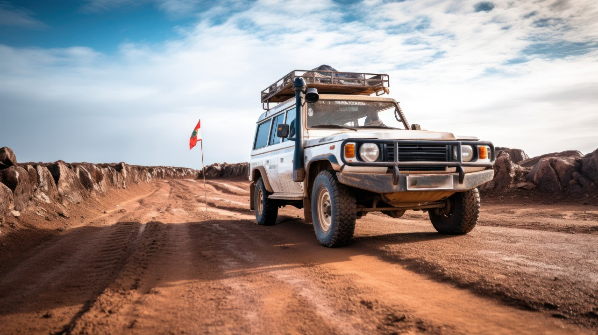

**In der heutigen Zeit ist es gar nicht so schwer, einen kleinen Beitrag zu leisten, um Menschen in Not oder schwierigen Verhältnissen zu helfen. Das geht mittlerweile sogar von zu Hause aus, ohne die eigenen "vier Wände" verlassen zu müssen. Darf ich vorstellen: das Humanitäre OpenStreetMap Team (HOT).**

HOT ist eine Non-Profit-Organisation, die sich darum bemüht, mit Geodaten dort zu helfen, wo es notwendig ist. Geodaten sind Daten, die Objekte mit einer Position auf der Erde beschreiben. Dies können z.B. Gebäude, Strassen oder Flüsse sein.

Früher waren Geodaten eine äusserst exklusive Ware, da es recht teuer war, diese zu erstellen. Geodaten wurden von Fachleuten mit teuren Gerätschaften erzeugt (Zeichenbretter, Flugzeuge, Satelliten etc.).

Und dann kam OpenStreetMap (OSM). OSM wurde im Jahr 2004 von Steve Coast gegründet und hat das Ziel, Geodaten zu demokratisieren. Der Name OpenStreetMap ist insofern etwas irreführend, als dass er suggeriert, dass es nur um Geodaten von Strassen ginge. Das trifft jedoch nicht zu, denn bei OSM werden Daten über nahezu beliebige Geo-Objekte erfasst (also insbesondere auch Gebäude, Bushaltestellen etc.), längst nicht nur Strassen.

Die Grundidee von OSM ist ähnlich wie die von Wikipedia: Jeder soll mithelfen können, die Daten zu erfassen und jeder darf die gemeinsam erzeugten Daten anschliessend kostenfrei verwenden. Bei Wikipedia sind diese Daten Wissensartikel, bei OSM sind es eben Geodaten. Das "Wiki-Prinzip" sorgt dafür, dass sich Vandalismus nicht breit machen kann. Die "Weisheit der vielen" (auch "Schwarmintelligenz" etc.) sorgt dafür, dass Fehler und Vandalismus einzelner durch andere ausgeglichen werden. Allgemein wird über Wiki-Prinzip gesagt, dass es in der Praxis gut funktioniere, nicht jedoch in der Theorie.

Als Steve Coast damals anfing, hatte er die Strassen Londons mit seinem GPS-Gerät abgefahren und so die ersten Geodaten für OSM erfasst. Heute ist dies nur eine Möglichkeit, Geo-Objekte zum Datenbestand hinzuzufügen. Denn mittlerweile haben einige Anbieter von Luftbildern ihren Datenschatz dem OSM-Projekt kostenfrei zur Verfügung gestellt. Auf Basis dieser Luftbilder können die auf der Erdoberfläche sichtbaren Objekte abgezeichnet werden.

Dies geschieht nun weltweit in einem atemberaubenden Umfang. Das Ergebnis dieser Bemühungen kann man eindrucksvoll im Hauptprodukt von OSM sehen, der OSM-Web-Karte:

<https://www.openstreetmap.org/>

Allerdings werden die Geodaten in OSM je nach Region mit unterschiedlicher Intensität erfasst. Dabei ist es gerade in Krisengebieten oder nach einem katastrophalen Ereignis von besonderem Interesse, dass in dem Gebiet mit hoher Aktivität Geodaten erfasst werden.

Denn Geodaten, z.B. bewohnte Gebäude oder befahrbare Strassen, können die Arbeit von Hilfsorganisationen und First Respondern extrem erleichtern. Meist sind fehlende, schlechte oder veraltete Karten oder Geodaten die Ursache dafür, dass die Hilfskräfte vor Ort nicht zielgerichtet tätig werden können. Und das kann im schlimmsten Fall Menschenleben kosten, oder zumindest kann Leid nicht effektiv gemildert werden.

Um genau diese Herausforderung anzugehen, wurde im Jahr 2010 von einer Gruppe von Freiwilligen die Organisation HOT gegründet. Es ist das erklärte Ziel von HOT, die Erfassung von Geodaten mit OSM speziell für humanitäre Einsätze zu koordinieren. HOT stellt Werkzeuge bereit, mit denen eine solche Koordination effizient gemanagt werden kann.

Das zentrale Anliegen von HOT ist es, dass jeder mit möglichst wenig Hürden sofort bei HOT mitmachen kann. Das kollaborative Erfassen von Geodaten ist tatsächlich nicht so schwer, wie es zunächst klingen mag und für den Einstieg ist auch kein besonderes Spezialistenwissen erforderlich. Es kann tatsächlich jeder sofort mitmachen. Trotzdem können gerade die ersten Schritte für Neueinsteiger manchmal etwas schwierig sein. Daher möchte ich in diesem Artikel den Einstieg in die HOT-Welt Schritt für Schritt beschreiben, und hoffe damit, einigen Zweiflern die Angst zu nehmen.

Das zentrale Werkzeug von HOT ist der "Tasking Manager":

<https://tasks.hotosm.org>

Der Tasking Manager ist eine Web-App, über die die Geodaten-Erfassung für humanitäre Einsätze koordiniert wird. Hier findet man also eine Übersicht der aktuellen Kartierungsprojekte über die der Einstieg in das Kartieren selbst erfolgt. Um mitmachen zu können, ist ein Einloggen notwendig. Der Tasking Manager unterstützt eine Vielzahl von Möglichkeiten der Authentifizierung (wie z.B. mit einem OSM-, Facebook-, Google- oder Microsoft-Konto). Sie müssen also womöglich nicht einmal ein neues Login-Konto anlegen, sondern können hier einfach ein bereits vorhandenes verwenden.

Nachdem Sie sich eingeloggt haben, kommen Sie durch einen Klick auf den Menü-Punkt "Kartierungsprojekte" zur Auflistung der aktuell angebotenen Projekte:

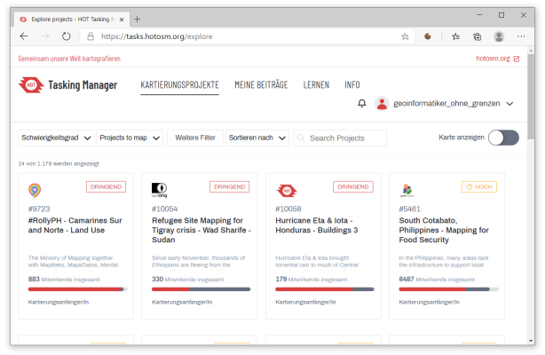

Jede "Box" repräsentiert ein Kartierungsprojekt in einer bestimmten Weltregion. In dem Screenshot oben sind z.B. vier Kartierungsprojekte aufgelistet: in Camarines, im Sudan, in Honduras und auf den Philippinen. Ausserdem werden in den Boxen diverse Meta-Informationen, wie z.B. die Dringlichkeit der Projekte oder der aktuelle Erfassungs-Fortschritt angezeigt.

An dieser Stelle empfiehlt es sich für Anfänger, die Filterfunktionen der Projektauflistung zu benutzen. Klicken Sie hierfür in der oberen Leiste auf den Dropdown-Button mit der Beschriftung "Schwierigkeitsgrad" und wählen Sie "Kartierungsanfänger/in" aus der Dropdown-Liste. Der Filter wird sofort aktiviert. Falls Ihnen ein Projekt aus der nun gefilterten Übersicht zusagt, klicken Sie einfach auf die jeweilige Box.

Auch hier ein Anfängertipp: Wählen Sie zu Beginn idealerweise ein Projekt aus, das noch nicht so weit fortgeschritten ist. Ein solches Projekt erkennen Sie daran, dass die Fortschrittsanzeige noch einen breiten hellgrauen Bereich hat. Unter den Projekten im oberen Beispiel wäre unter diesem Gesichtspunkte das Projekt "South Cotabato" am günstigsten, da hier in der Fortschrittsanzeige der hellgraue Anteil noch am grössten ist.

Wenn Sie nun so eine Box geklickt haben, kommen Sie auf die Seite des Projektbriefings. Hier erhalten Sie eine kurze textuelle Beschreibung des Erfassungsprojekts (meist nur auf Englisch), eine Darstellung des Erfassungsgebiets auf der Übersichtskarte, den Kartierungstyp, nochmals die Fortschrittsanzeige und diverse weitere Informationen zum Projekt:

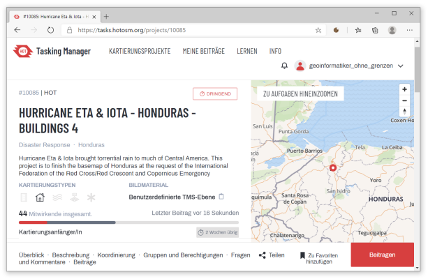

Der Kartierungstyp ist von besonderem Interesse, hier wird übersichtlich in Piktogrammen angezeigt, welche Art von Objekten in diesem Projekt zu erfassen sind. Grundsätzlich möglich sind die Typen "Strassen", "Gebäude", "Gewässer", "Landnutzung" und "Andere". Bei den meisten Projekten, so wie auch bei diesem, sollen Gebäude erfasst werden.

Steigen Sie in die Erfassung ein, durch einen Klick auf den Button "Beitragen" rechts unten. Sie kommen dann im nächsten Schritt auf die Detailansicht und zu den Anweisungen dieses Projekts. Hier können in der Karte auf der rechten Seite den konkreten Kartenausschnitt auswählen, in dem Sie erfassen möchten:

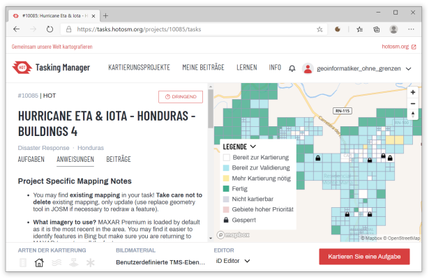

Klicken Sie dazu in der Karte auf eine Kachel. Als Anfänger wählen Sie idealerweise eine weisse Kachel, da es sich hierbei um Gebiete handelt, die laut Legende "Bereit zur Kartierung" sind. In den hellblauen Gebieten sind die Gebäude hingegen bereits erfasst worden und diese "warten" auf eine Validierung. Dies ist eher eine Aufgabe für fortgeschrittene Erfasser.

Wenn Sie eine Kachel gewählt haben, klicken Sie anschliessend auf den Button "Ausgewählte Aufgabe kartieren" unten rechts. Nun sind Sie am Ziel angelangt, im sog. "iD OpenStreetMap Editor", die dem die Hauptarbeit der Erfassung erfolgt. Wenn Sie den iD-Editor zum ersten Mal öffnen, können Sie einen Rundgang starten, oder Sie beginnen einfach direkt mit der Bearbeitung. Klicken Sie im Dialog-Fenster auf "Jetzt bearbeiten".

Sie sehen jetzt den iD-Editor:

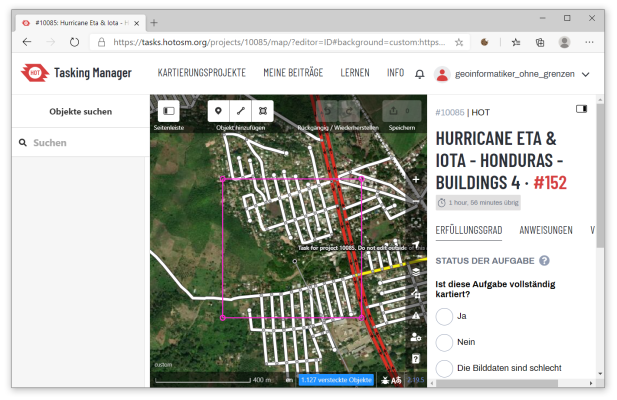

Mittig ist das Erfassungsgebiet pink umrandet in der Karte zu sehen. Die Karte enthält ein Luftbild und oben drüber die Geo-Objekte, die von anderen Usern bereits erfasst wurden. Sie sehen z.B. die Strassen als weisse Linien.

Rechts innerhalb der Karte sehen Sie die vertikale Werkzeugleiste. Vergewissern Sie sich zunächst, ob Sie Luftbilder von guter Qualität vorliegen haben. Klicken Sie dazu in der Werkzeugleiste auf das Werkzeug "Bildmaterial-Einstellungen" (oder drücken Sie einfach die Taste "b"). Wählen Sie in der dann erscheinenden Liste den Eintrag "Maxar Premium Imagery (Beta)":

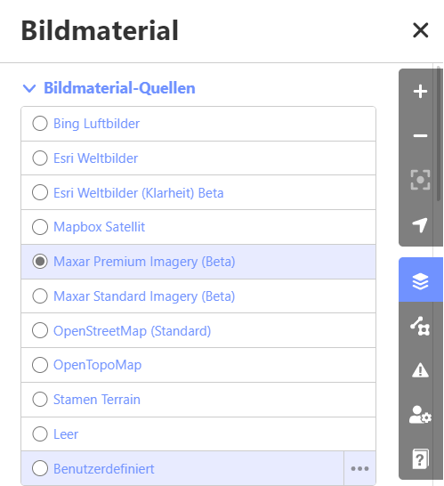

Schliessen Sie das Menü "Bildmaterial" anschliessend wieder. Klicken Sie danach auf das Plus-Symbol in der Werkzeug-Leiste, um in die Karte hinein zu zoomen. Zoomen Sie so weit hinein, bis Sie die einzelnen Gebäude gut erkennen können:

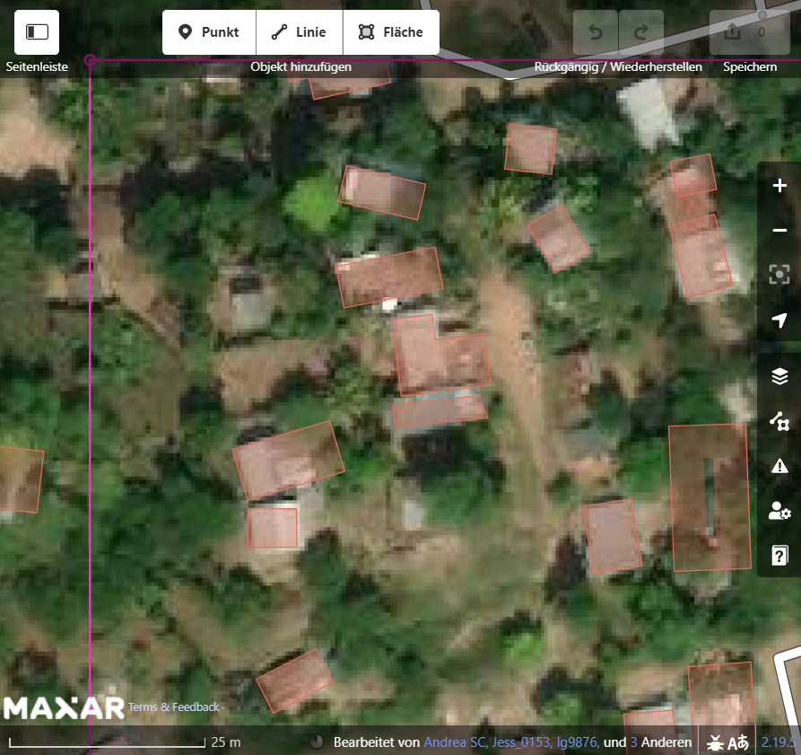

In diesem Kartenausschnitt ist das kleine Gebäude oben links noch nicht erfasst. Dies können wir nun nachholen, indem im oberen Rand der Karte auf den Button "Fläche" klicken. Nun dürfen wir schon mit dem Zeichnen beginnen, indem wir einfach in die Karte klicken und den Gebäuderand nachzeichnen:

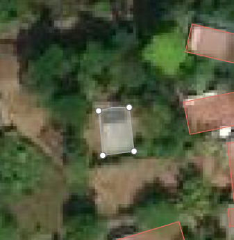

Jeder Klick in die Karte erzeugt einen Stützpunkt (eine Ecke) des Polygons, das anschliessend das Gebäude repräsentiert. Nach dem Klick des letzten Stürzpunktes, können die Erfassung mit Drücken der [ENTER]-Taste auf der Tastatur abschliessen.

Nun können wir dem iD-Editor noch mitteilen, dass es sich um ein Gebäude handelt, das wir da gerade eben erfasst haben. Dazu klicken wir im Menü auf der linken Seite auf den grossen, breiten Button "Gebäude":

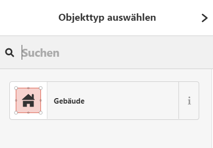

Und das war es, Sie haben damit im Grunde Ihr erstes Gebäude innerhalb eines humanitären Projekts für HOT erfasst.

Wir können die Erfassung nun noch qualitativ etwas verbessern. Die meisten Gebäude werden rechtwinklig gebaut und dies scheint auch in diesem Fall zuzutreffen. Leider ist es meist etwas schwer, freihändig rechtwinklig zu zeichnen. Hier wird man jedoch durch den iD-Editor unterstützt. Machen Sie hierzu einfach Rechtsklick auf das Eben erfasste Gebäude, ein Kontext-Menü öffnet sich sodann:

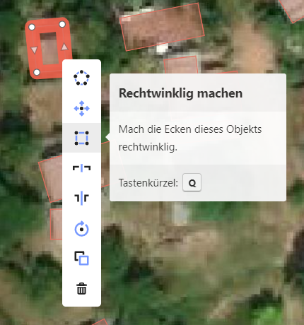

Im Kontext-Menü können Sie den Eintrag "Rechtwinklig machen" wählen (oder alternativ die Taste "q" drücken). Schon wird Ihr neu erfasstes Gebäude rechtwinklig.

Noch ist das erfasste Gebäude jedoch nicht publiziert. Die Publikation können Sie mit dem Button "Speichern" oben recht innerhalb der Karte anstossen:

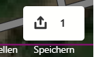

Nach dem Klicken von "Speichern" sehen Sie auf der linken Seite das Formular zum Hochladen bzw. Publizieren des neu erfassten Gebäudes:

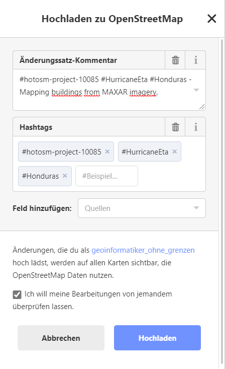

Hier wird praktischerweise das Kommentarfeld für diese Änderung bereits automatisch durch HOT vorausgefüllt. Sie brauchen hier also im Grunde nichts mehr zu tun, ausser direkt auf den Button "Hochladen" zu klicken. Falls Sie sich unsicher sind, ob Ihr neu erfasstes Gebäude wirklich von guter Qualität ist, können Sie vorher noch das Häckchen bei "Ich will meine Bearbeitung von jemandem überprüfen lassen" setzen.

Wenn Sie "Hochladen" geklickt haben, ist es im Grunde getan, Ihr neues Gebäude ist nun für alle (insbesondere für die Hilfskräfte vor Ort) sichtbar. In der Praxis bietet es sich an, erst mal mehrere Gebäude oder mehrere Objekte zu erfassen, bevor man auf "Speichern" klickt, sodass sich in einem einzelnen Änderungssatz eine grössere Menge an erfassten Geo-Objekten befindet.

Anschliessend sollten Sie noch das Gebiet wieder zur Bearbeitung für andere Erfasser freigeben. Klicken Sie hierzu im rechten Bereich des iD-Editors auf den Button "Aufgabe abspeichern":

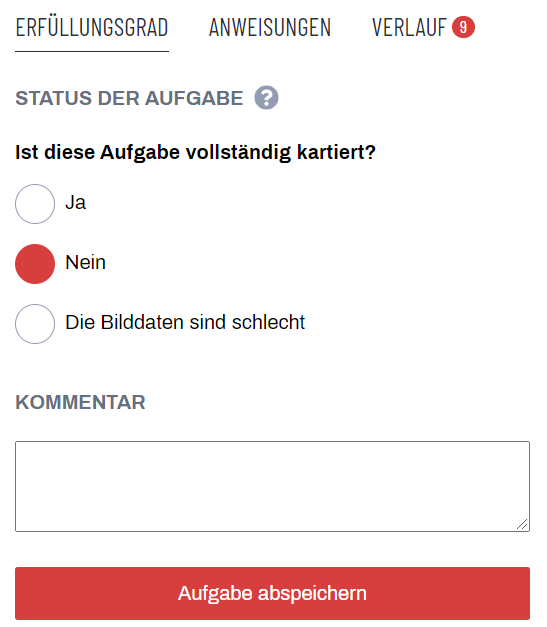

Damit verlassen Sie den iD-Editor und kehren zurück zur Detailansicht bzw. zu den Anweisungen des Projekts.

Ich hoffe, ich konnte Ihnen mit diesem Artikel einen kleinen Einblick geben, in die Möglichkeiten von HOT, und insbesondere Sie davon überzeugen, dass die Erfassung gar nicht so schwierig ist. Trauen Sie sich einfach! Jede Hilfe ist willkommen, jeder musste einmal anfangen.

Seien Sie sich vor allem sicher: Sie sind nicht allein, andere Erfasser stehen Ihnen zur Seite. Es ist vor allem die Vernetzung und die gegenseitige Hilfe, die HOT zu einer besonderen Gemeinschaft machen.
