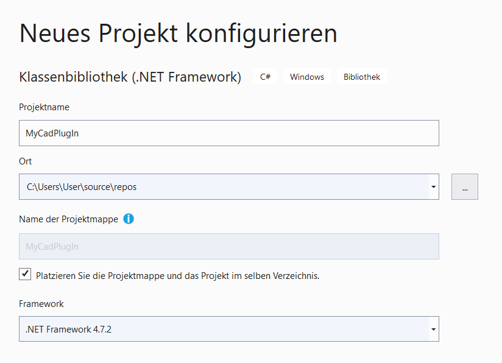
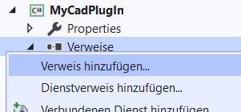
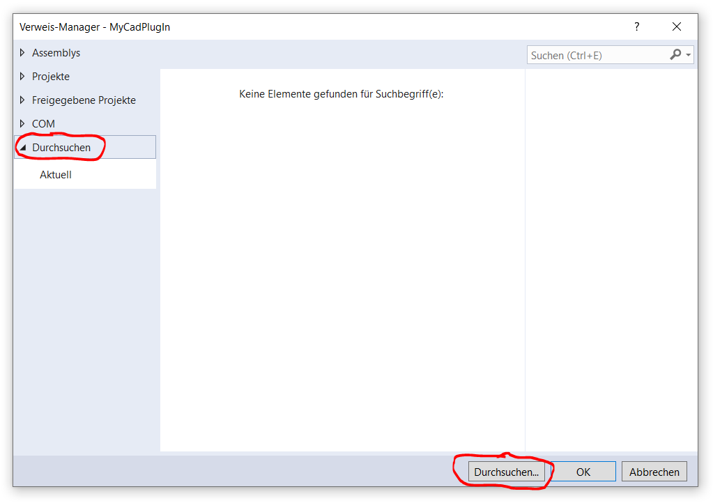
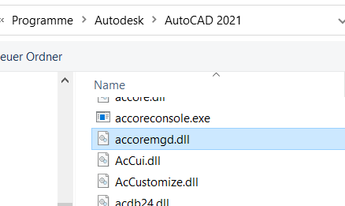
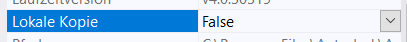
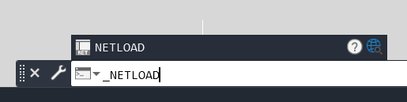
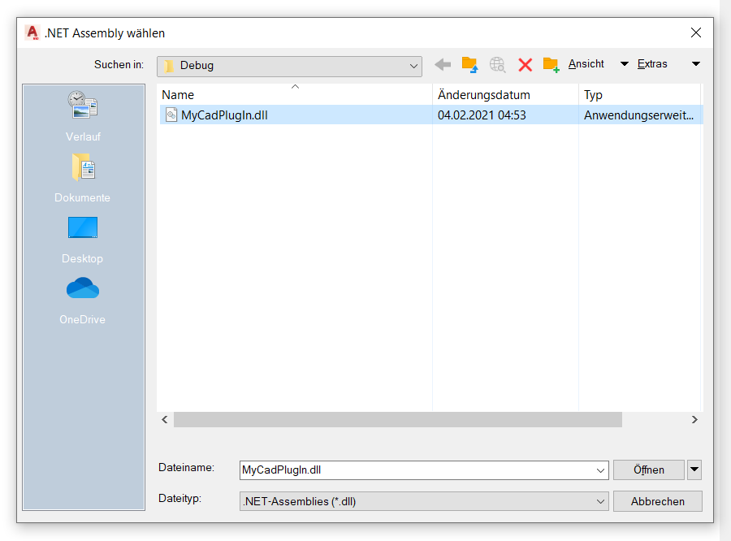
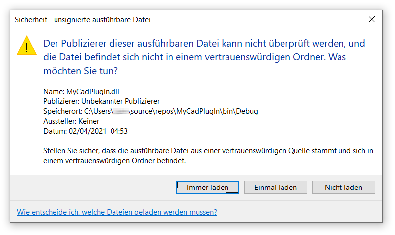

**Autodesk AutoCAD ist nach wie vor eines der beliebtesten Ingenieurs-Werkzeuge diverser Fachbereiche. Egal ob bei Architekten im Tief- oder Hochbau, bei Geodäten und Geoinformatikern oder bei Maschinenbauern im Automobil- oder im Flugzeugbau, AutoCAD ist häufig die zentrale Software in der täglichen Arbeit. Doch manchmal reichen die mitgelieferten Funktionen von AutoCAD nicht. Dann besteht die Möglichkeit, das CAD um eigene Funktionalität zu erweitern. Hier gibt es einen kurzen und knackigen Einstieg in die Entwicklung eigener AutoCAD-Erweiterungen.**

Sicherlich, Anleitungen zum initialen Einstieg in die AutoCAD-Programmierung mit dem .NET Framework und C# gibt es im Internet einige, und sie sind auch schon recht gut. Doch können diese für manche Einsteiger noch eher unzugänglich daher kommen. Daher möchte ich hiermit versuchen, einen besonders klaren, simplen und vor allem visuellen Workshop anzubieten, sodass der Einstieg definitiv gelingt. Das PlugIn ist in seinem Funktionsumfang denkbar einfach: Es soll die Zeichenkette "Hello AutoCAD world" auf die Kommandozeile in AutoCAD ausgeben, nichts weiter.

* Als Vorwissen werden *Programmierfähigkeiten in C#* und *Grundkenntnisse im Umgang mit AutoCAD* benötigt.
* Als Entwicklungs-Umgebung wird in diesem Workshop *Microsoft Visual Studio 2019* verwendet.
* Als Betriebssystem kommt *Windows 10* zum Einsatz, auf dem *AutoCAD 2021* installiert ist. Es ist darauf zu achten, dass das *SDK* des *.NET Framework* mit Visual Studio bereitgestellt wird (dies ist bei den meisten Installationen der Fall).

Wir starten als erstes Visual Studio und erstellen ein neues Projekt. Hierzu klicken wir im initialen Menü auf "Neues Projekt erstellen":


Als nächstes können wir den Projekttyp bestimmen. Hier wählen wir die "Klassenbibliothek (.NET Framework)":


Hier ist die Auswahl "Klassenbibliothek" notwendig, da nur diese Art eines Kompilats anschliessend als PlugIn in AutoCAD verwendet werden kann. Im Projekt-Template "Klassenbibliothek" werden als Ergebnis Programme produziert, die weder eigenständige Fenster- noch Befehlszeilen-Applikation sind. Das Ergebnis kann also nicht selbständig ausgeführt werden, sondern nur im Kontext einer anderen Software. Daher ist für AutoCAD-PlugIns der Projekt-Typ "Klassenbibliothek" zu wählen.

Als nächstes definieren wir die zentralen Aspekte des neuen Programmier-Projekts. Hier kann der *Projektname*, der *Speicherort* des Quelltexts und das *Ziel-Framework* bestimmt werden. In diesem Beispiel habe ich "MyCadPlugIn" als Projektname gewählt:



Für AutoCAD 2021 können wir die höchste verfügbare Version des .NET Frameworks wählen, in diesem Fall *Version 4.7.2*.

Und das wär's auch schon, damit wird die Projektmappe durch Visual Studio automatisch angelegt. Noch handelt es sich um ein ganz normales Projekt für die Programmierung von .NET-Bibliotheken. Daher wollen wir es in den nächsten Schritten erweitern, um die Möglichkeit, AutoCAD-Funktionen aufrufen zu können. Hierzu klicken wir im *Solution Explorer* mit der rechten Maustaste auf Verweise und anschliessend im Kontextmenü auf *Verweis hinzufügen...*:



Im daraufhin geöffneten Verweis-Manager klicken wir links im Menü auf den Menü-Eintrag *Durchsuchen* und anschliessend nochmal auf den unteren Button *Durchsuchen...*:



Es öffnet sich ein Dateiauswahl-Dialog. Hier dürfen wir jetzt die Datei `accoremgd.dll` finden. Wenn AutoCAD 2019 im Standard-Verzeichnis installiert wurde, dann finden wir diese Datei im Ordner:

```cmd
C:\Program Files\Autodesk\AutoCAD 2021\
```

Wenn Sie bei der Installation von AutoCAD einen anderen Zielordner bestimmt haben, können Sie an der entsprechenden Stelle schauen.

Wir wählen `accoremgd.dll` im Dateiwahl-Dialog aus und schliessend den Dialog durch eine Bestätigung mit OK:



Jetzt sollte sich im *Solution Explorer* unter *Verweise* ein entsprechender Verweis auf `accoremgd.dll` befinden. Wenn wir diesen Eintrag klicken, erscheinen im *Properties*-Bereich unten rechts diverse Eigenschaften dieses Verweises. Eine Eigenschaft heisst *Lokale Kopie*. Diese stellen wir auf *False* ein:



Die Eigenschaft *Lokale Kopie* bestimmt, ob beim Kompilieren des Programms eine Kopie der Datei `accoremgd.dll` in das Zielverzeichnis der Kompilation mit hinterlegt werden soll. Wir benötigen keine Kopie der DLL in das Zielverzeichnis, da unser PlugIn später in der Laufzeitumgebung von AutoCAD ausgeführt werden soll und dort steht diese DLL bereits im originären Quellverzeichnis bereit. Wir brauchen hier also keine Kopie, daher: *False*.

Nun ist das Projekt vorbereitet für die Entwicklung eines AutoCAD-PlugIns. Um etwas auf der Befehlszeile in AutoCAD ausgeben zu können, braucht es nicht viel. Wir schreiben folgenden Code in die Datei `MyCadPlugIn.cs` im Root-Verzeichnis des Projekts:

```c#
using Autodesk.AutoCAD.ApplicationServices;
using Autodesk.AutoCAD.ApplicationServices.Core;
using Autodesk.AutoCAD.EditorInput;
using Autodesk.AutoCAD.Runtime;

namespace MyCadPlugIn
{ 
  public class MyCommandClass
  {
    [CommandMethod("MyCadCommand")]
    public void MyCadCommand()
    {
      Document myDoc = Application.DocumentManager.CurrentDocument;
      Editor myEditor = myDoc.Editor;
      myEditor.WriteMessage("Hello AutoCAD world.");
    }
  }
}
```

Der gesamte Programmablauf findet in dem Fall innerhalb der Methode `MyCadCommand()` statt. Damit die Methode später in AutoCAD durch einen Befehl aufgerufen werden kann, müssen wir sie durch das Methoden-Attribut `CommandMethod` annotieren. Als Parameter übergeben wir an das Attribut den Namen des zukünftigen AutoCAD-Kommandos. Hier sind frei und können das Kommando bestimmen, wie wir möchten. Es sollte allerdings kein Kommando sein, das in AutoCAD bereits verwendet wird. In diesem Fall entscheide ich mich, das Kommando genau so zu benennen wir die Methode, also `MyCadCommand`. Dies ist aber nicht verpflichtend, Methode und Kommando können durchaus unterschiedlich benannt werden.

In der Methode verwenden wir die Klassen `Document`, `Application` und `Editor`. Die Klasse `Application` repräsentiert die zur Laufzeit aktiviert AutoCAD-Applikation selbst. Von dieser Klasse können wir über die Attributfolge `DocumentManager.CurrentDocument` ein Objekt der aktuell geöffneten AutoCAD-Zeichnung (Typ `Document`) erhalten.

Vom `Document`-Objekt wiederum könne wir über das Attribut `Editor` ein Objekt erhalten, das die AutoCAD-Befehlszeile repräsentiert. Und damit sind wir im Grunde schon am Ziel, denn am Befehlszeilen-Objekt können wir die Methode `WriteMessage` aufrufen, und dieser die Zeichenkette übergeben, die auf der Befehlszeile ausgegeben werden soll, in diesem Beispiel also "Hello AutoCAD world.".

Damit wäre das Programm fertig geschrieben. Wir kompilieren es für die "Veröffentlichung", indem wir in der oberen Leiste beim Kompilationsziel statt *Debug* nun auf *Release* umstellen und dann im Visual-Studio-Menü *Build* die Option *Neu erstellen* wählen. Anschliessend finden wir in unsere Projektordner im Unterordner Release das fertige Kompilat namens `MyCadPlugIn.dll`.

Nun können wir das Kompilat in AutoCAD laden. Wir öffnen AutoCAD und geben in der AutoCAD-Kommandozeile den Befehl:

```
_NETLOAD
```

ein. Wie der Befehlsname schon nahelegt, können mit *NETLOAD* in AutoCAD .NET-Framework-PlugIns geladen werden:



Nach dem Absetzen des Befehls öffnet sich wieder ein Dateiauswahl-Dialog indem wir die `MyCadPligIn.dll` im Unterverzeichnis Release des Programmier-Projekts suchen und auswählen:



Den anschliessenden Dialog bestätigen wir mit *Immer laden* oder *Einmal laden* (spielt hier keine Rolle):



Bei diesem Dialog handelt es sich um eine Sicherheitswarnung, die darauf hinweist, dass das PlugIn nicht signiert ist, und daher nicht sichergestellt werden kann, dass das PlugIn aus einer sicheren Quelle stammt. Das das PlugIn jedoch von uns kommt, wissen wir, dass es sicher ist und laden es daher trotzdem. Das Thema Signierung der PlugIns ist ein Thema für sich und wird hier nicht weiter betrachtet.

Nun ist unser PlugIn in AutoCAD geladen, und damit steht das von uns neu definierte Kommando in AutoCAD bereit. Wir können also in der Kommandozeile den Befehl *MYCADCOMMAND* ausführen:


Als Ergebnis sollte in der AutoCAD-Kommandozeile nun die Zeichenkette "Hello AutoCAD world." erscheinen.

Und damit war es das, wir haben unser erstes kleines AutoCAD-PlugIn geschrieben, kompiliert und in AutoCAD ausgeführt. In dem PlugIn haben wir auf Klassen aus der AutoCAD-API zugegriffen und diese verwendet. Das ist doch schon mal ein toller Erfolg!
