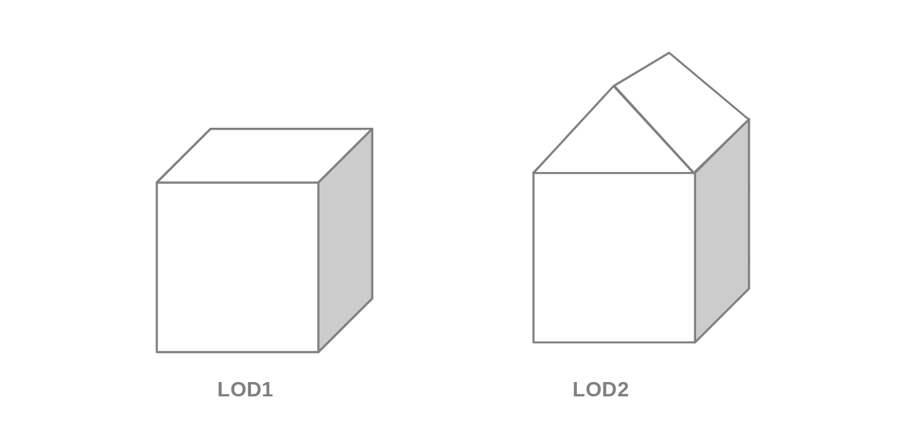
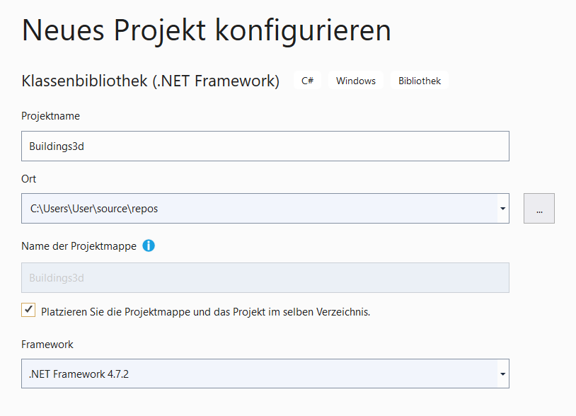
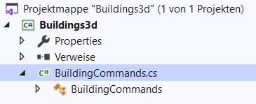
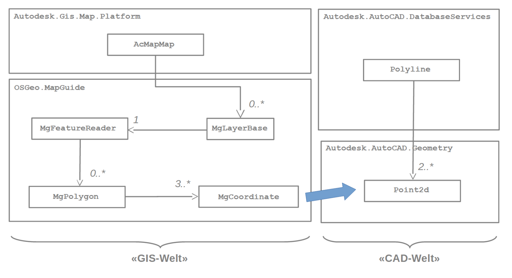
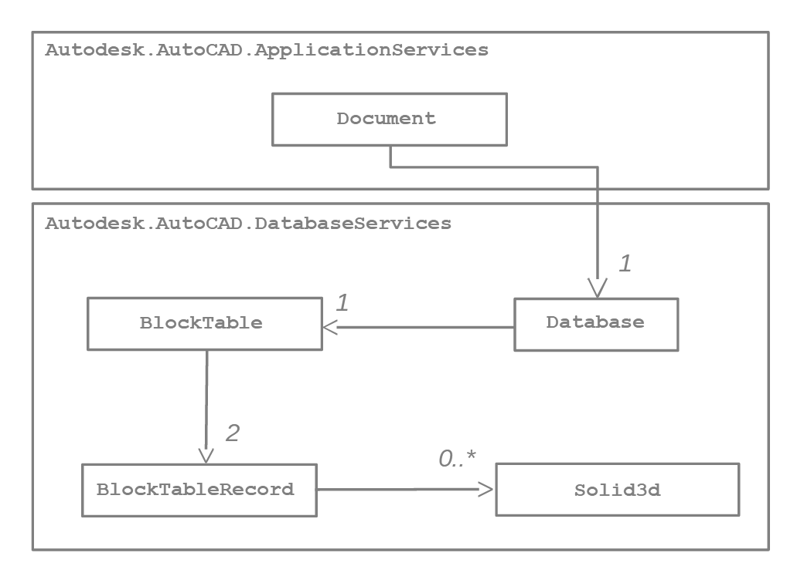
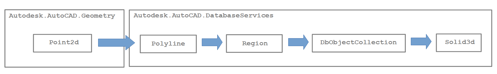
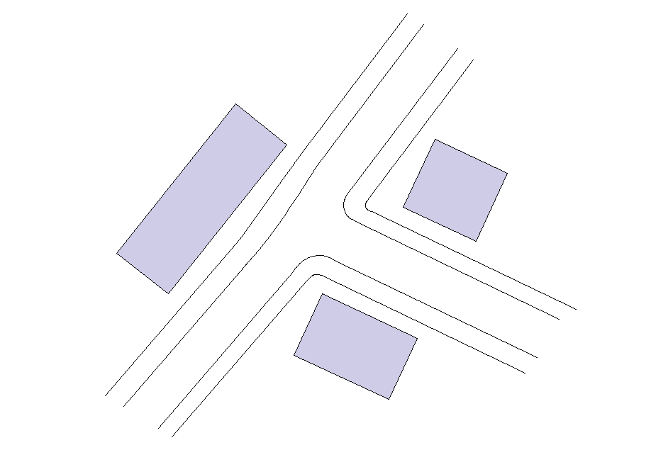
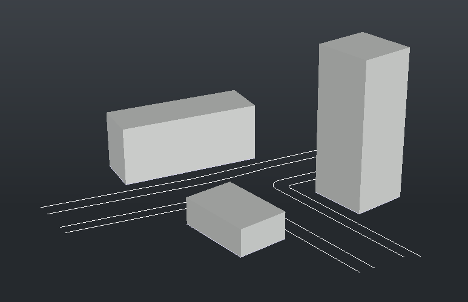

**Das digitale Gebäude - es hat sich zu einem zentralen Instrument in der Praxis entwickelt, bei Architekten, Stadtplanern, Stadtwerken, im Tiefbau aber auch bei der Polizei und der Feuerwehr. 3D-Gebäudeobjekte sind in der Praxis häufig gefragt, da sie einen Mehrwert im Vergleich zu reinen 2D-Daten bieten, nicht nur für die Visualisierung, sondern auch in Analyseverfahren. Im Grunde gibt es kaum einen Fachbereich, der nicht von 3D-Gebäudedaten profitieren kann. In diesem Workshop programmieren wir ein PlugIn für AutoCAD Map, das einfache 3D-Gebäudemodelle aus zweidimensionalen Gebäudegeometrien der Amtlichen Vermessung erzeugen soll.**

Das Thema "3D-Gebäudegeometrien" ist in seiner Gesamtheit aus technischer Sicht komplex und kann in diesem Artikel nur rudimentär angeschnitten werden. Ich werde hier daher nur die wichtigsten Eckpunkte der Theorie einbringen können. Viel wichtiger ist mir in diesem Workshop der praktische Umgang mit dem Thema, daher liegt der Fokus auf der Programmierung mit 3D-Gebäudemodellen innerhalb einer praxisrelevanten Anwendungsumgebung, in diesem Fall Autodesk AutoCAD Map. Die Wahl fiel auf AutoCAD Map, da es ein präzises Ingenieurswerkzeug ist, das z.B. von Architekten, Stadtplanern oder in der Infrastrukturplanung verwendet wird, also überall dort, wo 3D-Gebäudemodelle relevant sind.

Für diesen Workshop werden folgende Fähigkeiten vorausgesetzt:

* Kenntnisse in der Programmierung mit der Sprache C# (klassisches .NET-Framework),
* Praxiserfahrung im Computer Aided Design (CAD),
* Praxiserfahrung im Umgang mit Geoinformationssystemen (GIS).

AutoCAD Map ist ein sogenanntes "Specialized Toolset" für AutoCAD und stellt die GIS-Erweiterung von AutoCAD dar. Es ist eine Art "Brücke" zwischen der CAD- und der GIS-Welt. CAD und GIS liegen elementar unterschiedliche Konzepte zugrunde. Während der Fokus von CAD-Systemen auf dem Zeichnen von einzelnen Realweltobjekten in Plänen liegt (kleinräumig in einem lokalen Koordinatensystem), ist der Zweck von GIS, die Realweltobjekte grossräumig auf Karten im Kontext der Erde zu verwalten. Trotzdem gibt es eine Menge praxisrelevante Schnittpunkte zwischen diesen "Welten". AutoCAD Map versucht diese beiden Welten zusammenzubringen, es kommt aus der CAD-Welt und wurde um diverse GIS-Funktionen erweitern. Im Grunde besteht AutoCAD Map aus zwei Anwendungen in einem: CAD und GIS. Daher ist es in der Praxis so beliebt. Auch mit dem PlugIn, das wir in diesem Workshop gemeinsam entwickeln, schlagen wir weitere Brücken zwischen CAD und GIS.

In der praktischen Verwendung gibt es nicht DAS geometrische Modell für 3D-Gebäude, sondern eine Vielzahl von unterschiedlichen Modellen, die an den jeweiligen Einsatzzweck angepasst sind. Einsatzzwecke können z.B. das Building Information Modeling (BIM), die Infrastrukturplanung oder einfach die Visualisierung für den Tourismus sein. Grundsätzliche Unterscheidungsformen für die Repräsentation von 3D-Gebäudemodellen sind z.B.

* Boundary-Representation (B-Rep),
* Constructive Solid Geometry (CSG),
* Simplizialer Complex.

Die B-Rep modelliert die Geometrie der Gebäude als Randgeometrien. So wird das Volumen des Gebäudes als eine Menge von zusammenhängenden Randflächen abgebildet. Die Randflächen wiederum werden als eine Menge von zusammenhängenden Randlinien modelliert. Der Vorteil von B-Rep ist die einfahe, direkte Modellierbarkeit der Geometrie, der Nachteil ist eine fehleranfällige Volumenbildung. Die CSG hingegen ist ein völlig anderer Ansatz der Modellierung, bei der die Gebäudegeometrien aus mathematisch definierten geometrischen Elementen durch boolesche Operatoren zusammengesetzt werden. So kann ein 3D-Gebäude z.B. aus einem Würfel (geometrisches Element) und einem extrudierten Dreieck (für das Dach) repräsentiert werden. Der Vorteil ist eine garantierte Volumenbildung: eine Gebäudegeometrie hat durch diese Modellbildung immer ein definiertes Volumen. Beim Simplizialen Complex wiederum wird ein 3D-Objekt durch eine Zerlegung in die geometrischen Primitive der jeweiligen Dimension (sog. Simplizes) abgebildet. Auch hier ist eine Volumenbildung garantiert, jedoch ist die Erzeugung einer solchen Geometrie recht aufwändig.

Im GIS-Bereich hat sich international der CityGML-Standard des Open Geospatial Consortium (OGC) für 3D-Gebäudemodelle etabliert. CityGML ist XML-basiert und definiert ganze 3D-Stadtmodelle, mit Gebäuden, Bäumen, Stadtmöblierung, Wasserflächen etc. Das zugrundeliegende Geometriemodell ist die B-Rep, d.h. die 3D-Objekte werden als Randflächen modelliert (siehe oben). Das Gebäudemodell aus CityGML definiert vier sog. Levels of Detail (LOD), den

* LOD0 (2D-Gebäudegrundrisse),
* LOD1 (Klötzchenmodell),
* LOD2 (Gebäude mit Dachform, Dachaufbau und Fenstern) und
* LOD3 (Architekturmodell: Gebäude mit Innenraum-Modellierung und detailliert modellierten Fassaden).

In der LOD1-Repräsentation werden also weder die korrekten Dachformen modelliert, noch irgendwelche Dachaufbauten, wie z.B. Gauben.

Auf stadtweiter Ebene sind vor allem LOD1 und und LOD2 von praktischem Interesse und aktuell realistisch in der Erhebung und Nachführung. Im einfachsten Beispiel wird ein Gebäude in LOD1 als Klötzchen und im LOD2 als Gebäude mit Dachform (hier: Satteldach) modelliert, wie in der folgenden Abbildung:



LOD1 genügt bereits für die meisten Anwendungen, insbesondere für 3D-Analysen, wie z.B. Lärm-, Funkwellen-, oder Schadstoffausbreitungen zwischen den Gebäudegassen auf Stadtebene. In einigen Fällen ist LOD1 für analytische Zwecke sogar besser geeignet, da einfachere Geometrien schneller zu rechnen sind und weniger Probleme mit geometrischen Spezialfällen bereiten.

Nun aber genug zur Theorie, kommen wir zur Praxis. Zunächst können wir in Visual Studio ein Programmier-Projekt für ein AutoCAD-PlugIn eröffnen. Wir erzeugen also ein neues Projekt und nennen es z.B. "Buildings3d":



Wir richten das Projekt für das ".NET Framework 4.7.2" ein.

Das vollständige Vorgehen für die Erstellung deines AutoCAD-Entwicklungsprojekts wird nicht in diesem Workshop behandelt, stattdessen verweise ich auf meinen anderen Workshop, der genau dieses Thema behandelt:


> **📰 Artikel-Hinweis**
>
> **Thema:** So schreiben Sie ein PlugIn für AutoCAD auf Basis des .NET Frameworks  
> **Link:** [▶ Artikel öffnen](https://edgarbutwilowski.github.io/technik-und-teilhabe/beitraege/2021-02-net-plugin-autocad/)
>

Nachdem die Projekt-Basis entsprechend dem Workshop eingerichtet ist, sollten wir noch einige weitere Verweise auf externe Programmier-Bibliotheken (DLLs) hinzufügen. Folgende DLLs werden zusätzlich benötigt (die Pfade beziehen sich auf eine Standard-Installation von AutoCAD 2021):

* `C:\Program Files\Autodesk\AutoCAD 2021\acdbmgd.dll`
* `C:\Program Files\Autodesk\AutoCAD 2021\acmgd.dll`
* `C:\Program Files\Autodesk\AutoCAD 2021\Map\Autodesk.Map.Platform.dll`
* `C:\Program Files\Autodesk\AutoCAD 2021\Map\bin\GisPlatform\OSGeo.MapGuide.PlatformBase.dll`
* `C:\Program Files\Autodesk\AutoCAD 2021\Map\bin\GisPlatform\OSGeo.MapGuide.Geometry.dll`
* `C:\Program Files\Autodesk\AutoCAD 2021\Map\bin\GisPlatform\OSGeo.MapGuide.Foundation.dll`

Bei allen diesen externen Verweisen, bitte daran denken, in Visual Studio die "Lokale Kopie" auf "False" zu setzen, sodass die referenzierten DLLs nicht in den Visual-Studio-Projektordner kopiert werden (dies ist nicht notwendig, da die DLLs zur Laufzeit von AutoCAD alle bereits vorliegen).

Nun sind die Verweise vollständig eingerichtet. Idealerweise benennen wir noch dir zentrale Klasse und C#-Datei des Projekts in etwas sprechenderes um, wie z.B. `BuildingCommands`:



In der Klasse `BuildingCommands` erstellen wir eine einzige Methode mit der Bezeichnung `CreateBuilding()`:

```cs
using ... // hier noch ergänzen
          // Siehe Folgeschritt im Artikel
...
namespace Buildings3d
{
  public class CreateBuildingClass
  {
    [CommandMethod("CREATEBUILDING")]
    public void CreateBuilding()
    {
      ... // hierhin kommt der eigentliche
      ... // Programm-Code des PlugIns
    }
  }
}
```

Die Methode wird mit dem Methoden-Attribut CommandMethod (aus dem Namensraum Autodesk.AutoCAD.Runtime) versehen. In dem Attribut definieren wir das AutoCAD-Kommando, mit dem wir später diese Methode in AutoCAD starten können (in diesem Fall "CREATEBUILDING". Im Grunde können wir hier eine beliebige Zeichenkette angeben, sie sollte jedoch nicht durch ein anderes AutoCAD-Kommando bereits belegt sein.

Bei der Gelegenheit können wir im Kopf der Datei gleich alle Namensräume angeben, die wir mit diesem PlugIn verwenden werden, diese sind:

```cs
using System.Collections.Generic;
using Autodesk.AutoCAD.ApplicationServices;
using Autodesk.AutoCAD.DatabaseServices;
using Autodesk.AutoCAD.EditorInput;
using Autodesk.AutoCAD.Geometry;
using Autodesk.AutoCAD.Runtime;
using Autodesk.Gis.Map.Platform;
using Autodesk.Gis.Map.Platform.Interop;
using OSGeo.MapGuide;
...
```

Damit wäre der Rahmen für unsere Kernfunktionalität vorbereitet. Die gesamte Funktion, die wir programmieren werden, kommt in den Rumpf der oben vorbereiteten Methode CreateBuilding().

Und als erstes können wir in diesem Rumpf den Benutzer darum bitten, Geometrie-Objekte in der Karte von AutoCAD zu selektieren. Hierzu starten wir mit dem Dokument-Objekt (Klasse Document aus dem Namensraum Autodesk.AutoCAD.ApplicationServices), das das in AutoCAD jeweils aktuell geöffnete Zeichnungsdokument repräsentiert:

```cs
...
Document myDoc = Autodesk.AutoCAD.ApplicationServices.Application.
             DocumentManager.MdiActiveDocument;
Editor myEditor = myDoc.Editor;
PromptSelectionResult psr = myEditor.GetSelection();
if(psr.Status != PromptStatus.OK)
{
  return;
}
SelectionSet selSet = psr.Value;
...
```

Es gibt daher nur ein eindeutiges Dokument-Objekt in der AutoCAD-API, da ein AutoCAD-Kommando nur innerhalb einer geöffneten Zeichnung ausgeführt werden kann. Vom Dokument-Objekt aus können wir den Editor abrufen. Der Editor repräsentiert die Kommandozeile von AutoCAD. Durch den Aufruf der Methode GetSelection() am Editor-Objekt wird der AutoCAD-Benutzer dazu aufgefordert, Geometrie-Objekte per Klicken oder Ziehen in der Zeichnung auszuwählen.

Das Ergebnis der Auswahl des Benutzers, in Form eines PromptSelectionResult-Objekts, können wir auf den Status hin prüfen. Der Status der Auswahl muss den Wert PromptStatus.OK aufweisen, ansonsten hat der Benutzer die Auswahl abgebrochen, oder etwas anderes ist schiefgelaufen. Falls etwas schiefgelaufen ist, brechen wir an der Stelle durch ein return-Statement die Verarbeitung der gesamtem Methode ab. Falls hingegen die Auswahl funktioniert hat, können wir abschliessend die Menge der selektierten Objekte in Form eines SelectionSet abgreifen.

Bevor wir nun zur Kernfunktion unseres PlugIns vordringen, schauen wir uns zunächst einmal die technische Ziel-Architektur etwas genauer an. In Arbeitsumgebungen mit einem hohen Anspruch an Datenintegrität werden die in AutoCAD Map erzeugten Geodaten in einer Geodatenbank gespeichert. Hier kann Oracle Spatial oder der Microsoft SQL Server verwendet werden. In so einem Fall kommt ein sogenanntes Autodesk Industry Model zum Einsatz, das das Schema der Daten und die verwendeten Geometrietypen in der Datenbank definiert.

Im Industry Model der Allgemeinen Vermessung werden die Gebäudegrundrisse als Polylinien geführt (z.B. in der Bodenbedeckung). Diese Polylinien sind Objekte der sog. FDO-Technologie von Autodesk (wobei FDO für Feature Data Objects steht). Es ist wichtig zu verstehen, dass die FDO-Datentypen sich grundlegend von den Standard-Datentypen des "klassischen" AutoCAD (also als reines CAD) unterscheiden. Auch im Basis-AutoCAD (ohne Map) gibt es einen Polylinien-Datentyp, dieser ist jedoch nicht kompatibel mit den FDO-Polylinien.

In diesem Workshop wollen wir jedoch 3D-Gebäudemodelle als integraler Teil einer AutoCAD-Zeichnung erstellen, nicht als FDO-Objekte. Dies hat den Vorteil, dass die 3D-Gebäude mit der AutoCAD-Zeichnung (DWG/DXF) "mitwandern", also die 3D-Gebäude z.B. einfach per E-Mail-Anhang versendet werden können (dies funktioniert bei FDO-Objekten nicht). Für eine Übersetzung zwischen den GIS-Polylinien (FDO) und den CAD-Polylinien (AutoCAD ohne Map) müssen wir sorgen.

Als erstes benötigen wir also Zugriff auf den Gebäudegrundriss aus der Datenbank, also aus dem Autodesk Industry Model der Allgemeinen Vermessung. Dazu betrachten wir zunächst einmal das Datenmodell für GIS-Daten (also FDO-Datentypen) in AutoCAD Map (siehe linke Seite in folgender Abbildung):



In der "GIS-Welt" links finden wir folgende Klassen-Abhängigkeiten: Als "Einstieg" in die GIS-Objekte findet sich ganz oben die Klasse AcMapMap. Diese repräsentiert die gesamte digitale (GIS-)Karte, die jeweils aktuell (zum Zeitpunkt der Ausführung des PlugIns) im AutoCAD-Dokument geöffnet ist. Die AcMapMap ist statisch und global einmal verfügbar, es kann also direkt zu Beginn unseres Programm-Codes abgegriffen werden. An der digitalen Karte wiederum hängen beliebig viele GIS-Layer (siehe Klasse MgLayerBase).

Wir gehen über das Karten-Objekt (AcMapMap) und schliesslich über die Layer-Liste (MgLayerCollection) zum relevanten GIS-Layer (MgLayerBase). Der hier relevante Layer hat die Bezeichnung "Gebäudegrundrisse":

```cs
...
AcMapMap map = AcMapMap.GetCurrentMap();
MgLayerCollection layerColl = map.GetLayers();
MgLayerBase layer = layerColl.GetItem("Gebäudegrundrisse");
... 
```

Die genaue Bezeichnung des GIS-Layers mit den Gebäudegrundrissen kann von Industry Model zu Industry Model variieren, d.h. für Ihren konkreten Fall wäre diese Zeichenkette evtl. anzupassen.

Der GIS-Layer (MgLayerBase) liefert uns über den MgFeatureReader eine Möglichkeit, die Geodaten-Features des Layers zu lesen und ist auch zugleich eine Repräsentation der einzelnen konkreten Features. Hierbei wollen wir jedoch nicht alle Features des Layers, sondern nur die vom Benutzer selektierten Features zur weiteren Verarbeitung filtern. Der Filter wird angesetzt, indem dem Objekt der Benutzer-Selektion (MgSelectionBase) in dessen GetSelectedFeatures()-Methode der GIS-Layer der Gebäudeumrisse (im Beispiel das Objekt layer) und dessen Titel (im Beispiel layer.FeatureClassName) übergeben wird:

```cs
...
MgSelectionBase selectBase = AcMapFeatureEntityService.GetSelection(selSet);
MgFeatureReader readFeat = 
       selectBase.GetSelectedFeatures(layer, layer.FeatureClassName, false);
...
```

Wir müssen hier sozusagen invertiert denken: Aus den durch den Benutzer selektierten Geometrien werden nochmals nur jene gefiltert, die auf dem gewünschten GIS-Layer liegen. Durch diese Routine wird sichergestellt, dass der Benutzer nur Geometrien auf dem richtigen Layer der Gebäudegrundrisse auswählen kann und keine anderen. Der dritte Parameter der Methode GetSelectedFeatures() definiert, ob die returnierten Feature-Objekte alle Feature-Attribute enthalten sollen (Wert: false) oder nur die gemappten (Wert: true). In diesem Beispiel entscheiden wir uns für alle.

Vom MgFeatureReader können wir auch die Geometrie des Features erhalten, in unserem Fall sind das immer Polygone (vom Typ MgPolygon). Hierzu benötigen wir zusätzlich noch ein Objekt vom Typ MgAgfReaderWriter (aus dem Namensraum OSGeo.MapGuide), das in Kombination mit dem MgFeatureReader die Geometrie-Objekte aus der Datenbank auslesen kann.

Nun folgt der Kern-Prozess des PlugIns, nämlich der Übergang von der GIS- in die CAD-Welt. Im folgenden Code-Schnipsel wird das Polygon aus der GIS-Datenbank in eine Polylinie der CAD-Zeichnung umgewandelt. Dies ist notwendig, da die 3D-Gebäude, die wir als Ergebnis erzeugen werden, auch Objekte der CAD-Welt sind und als Basislinie selbst ein CAD-Objekt (Polylinie) benötigen.

```cs
...
MgAgfReaderWriter readWriter = new MgAgfReaderWriter();
DBObjectCollection curveSegments = new DBObjectCollection();
List<double> traufenhoehen = new List<double>();

while (readFeat.ReadNext())
{
  ... // hier erfolgt die Verarbeitung
  ... // jedes einzelnen Features der
  ... // gewählten Menge
}

readFeat.Close();
...
```

Im obigen Code-Abschnitt iterieren wir in der while-Schleife über alle vom Benutzer ausgewählten Features des "Gebäudegrundrisse"-Layers. Da es sich hierbei um das Feature handelt, das das Geo-Objekt in der Datenbank repräsentiert, können wir weitere attributive Daten des Geo-Objekts abfragen.

Wir gehen an dieser Stelle davon aus, dass sich in der Datenbank-Tabelle (die den "Gebäudegrundrisse"-Layer definiert) auch ein Attribut mit der Bezeichnung "traufenhoehe" befindet. In diesem Attribut haben die Erfasser der Gebäudegrundrisse immer jeweils auch die Höhe des Gebäudes bis zur Gebäude-Traufe in der Einheit Meter mit erfasst. Wir können hier nun von jedem Feature durch Aufruf der Methode GetDouble("traufenhoehe") die Traufenhöhe auslesen:

```cs
...
double traufenhoehe = readFeat.GetDouble("traufenhoehe");
traufenhoehen.Add(traufenhoehe);
...
```

Bei traufenhoehe wird ein double-Datentyp verwendet, da die Erfassung in der Datenbank mit einer höheren Genauigkeit als "Meter" erfolgt und damit auch Nachpunktstellen relevant sind. Alle traufenhoehe-Werte legen wir für die spätere Verwendung zunächst in einer Liste (List<double>) ab.

Als nächstes lesen wir das räumliche Attribut (also das Polygon) des Features aus:

```cs
...
MgGeometry geom = readWriter.
      Read(readFeat.GetGeometry(layer.GetFeatureGeometryName()));
MgPolygon poly = (MgPolygon)geom;
...
```

An dieser Stelle ist zu beachten, dass die Polygone vom Typ MgPolygon eben das Polygon der FDO-Datentypen repräsentiert und nicht kompatibel ist mit den Datentypen des klassischen AutoCAD. Es ist völlig anders definiert als das Polygon in AutoCAD, stattdessen würde es eher der Polyline von AutoCAD (CAD-Polylinie) entsprechen, steht jedoch in der Typendefinition in keiner Beziehung zu dieser. Um also eine Transformation von den GIS- in CAD-Objekte zu erwirken, sollten wir das MgPolygon manuell in eine Polyline überführen. Dies können wir über die Koordinaten bewerkstelligen. Während bei FDO die Koordinaten des MgPolygon in Form von MgCoordinate-Objekten geliefert werden, benötigen die CAD-Polylinien Koordinaten in Form von Point2d-Objekten. Wir erzeugen also neue Point2d-Objekte, übertragen die Koordinaten aus den MgCoordinate-Objekten einzeln auf die Koordinaten der Point2d-Objekte und verwenden anschliessend die Point2d-Objekte als Koordinaten der CAD-Polylinien:

```cs
...

MgCoordinateIterator coords = poly.GetCoordinates();
Polyline pline = new Polyline();


int i = 0;
while (coords.MoveNext())
{
  MgCoordinate coord = coords.GetCurrent();
  pline.AddVertexAt(i, new Point2d(coord.GetX(), coord.GetY()), 0, 0, 0);
  i++;
}

curveSegments.Add(pline);
...
```

Damit wäre die Verarbeitung innerhalb der while-Schleife abgeschlossen.

Die Koordinaten der Allgemeinen Vermessung (hier vorliegend im Objekt MgCoordinate) liegen für gewöhnlich in einem projizierten Koordinatensystem vor (in der Schweiz z.B. in "LV95"), d.h. diese Koordinaten sind bereits in eine Fläche projiziert und haben eine metrische Einheit.

Nun kommen wir zum letzten Teil des Prozesses. Da wir jetzt mit der Polyline ein Objekt haben, das die Geometrie des Gebäudegrundrisses in der CAD-Welt repräsentiert, können wir dieses Objekt als Basis verwenden, um daraus ein LOD1-3D-Gebäude im CAD (also speicherbar im DWG/DXF-Dokument) zu erzeugen.

Dazu sollten wir zunächst einen Blick darauf werfen, wie die Objekte in einer AutoCAD-Zeichnung (DWG/DXF-Dokument) verarbeitet und gespeichert werden. Die API hat hierbei nämlich eine Besonderheit, denn der Umgang mit Objekten wird in einer AutoCAD-Zeichnung in Form von typischen Datenbank-Transaktionen abgebildet. Der Einstieg in den Umgang mit Objekten in einer AutoCAD-Zeichnung gelingt wiederum über das bereits bekannte Document-Objekt, das die AutoCAD-Zeichnung selbst repräsentiert:



Vom Document-Objekt können wir ein Database-Objekt erhalten. Jedes AutoCAD-Zeichnungs-Dokument hat genau eine Datenbank integriert. Die Datenbank ist so aufgebaut, dass sie einen einzigen BlockTable beinhaltet, der wiederum zwei BlockTableRecords umfasst. Die beiden BlockTableRecords repräsentieren den Model-Space und den Paper-Space. Eine AutoCAD-Zeichnung hat immer einen sog. Model-Space (in dem gezeichnet wird) und einen Paper-Space (in dem das Drucklayout definiert wird). Da wir mit Zeichnungs-Objekten arbeiten wollen, greifen wir hier auf den Model-Space zu.

Und nun sind wir schon ganz nahe an den 3D-Gebäude-Geometrien, denn in den BlockTableRecord können wir die Geometrien hineinschreiben, die in der AutoCAD-Zeichnung als "reines" CAD-Objekt sichtbar werden sollen, also eben auch die 3D-Gebäude-Geometrien. In diesem Fall können die Gebäude als Solid3d-Objekte speichern. Ein Solid3d-Objekt ist ein CSG-Modell (siehe ganz oben).

Um von der Polyline des Gebäudegrundrisses (die wir bereits haben), ein Solid3d zu erhalten, können wir die Polyline in die Höhe extrudieren. Hierzu bietet die AutoCAD-API die Methode Extrude() am Solid3d-Objekt an. Der Weg von der Polyline zum Solid3d ist also folgender:



Wir können also von der Polyline zunächst eine Region erzeugen. Die Region ist in der CAD-Welt das Pendant zum MgPolygon aus der GIS-Welt, also das Flächenobjekt, das durch die Polyline gebildet wird. In unserem Fall ist es die "Bodenplatte" des Gebäudes.

Da der Benutzer im ersten Schritt (siehe ganz oben) mehrere Gebäudegrundrisse in der Karte gewählt haben könnte, kann es sein, dass wir auch mehrere Polylines und Regions vorliegen haben, weshalb wir die Regions in einer Sammlung (DBObjectCollection) zusammentragen sollten. Dies sieht im Code dann folgendermassen aus:

```cs
...
Database drawingDb = myDoc.Database;
using (Transaction trans = drawingDb.TransactionManager.StartTransaction())
{

  BlockTable blockTable =
       trans.GetObject(drawingDb.BlockTableId, OpenMode.ForRead)
                as BlockTable;
  BlockTableRecord blockTableRecord =
       trans.GetObject(blockTable[BlockTableRecord.ModelSpace],
                OpenMode.ForWrite) as BlockTableRecord;


  DBObjectCollection regions = Region.CreateFromCurves(curveSegments);

  ... // hier folgt die Erzeugung
  ... // der 3D-Gebäude-Geometrien

}
...
```

Nun fehlt nur noch die Erstellung der Solid3d-Objekte. Hierzu iterieren wir über die eben befüllte DBObjectCollection, die die Regions enthält und extrudieren jede Region mit dem jeweiligen Höhenwert der Traufenhöhe:

```cs
...
int i = 0;
foreach(Region reg in regions)
{
  Solid3d solid = new Solid3d();
  solid.Extrude(reg, traufenhoehen[i], 0.0);
  blockTableRecord.AppendEntity(solid);
  trans.AddNewlyCreatedDBObject(solid, true);
  i++;
}
trans.Commit();
...
```

Abschliessend wird jedes neu erzeugte LOD1-3D-Gebäude (Solid3d-Objekt) im BlockTableRecord (also in der Datenbank der jeweils aktuellen AutoCAD-Zeichnung) gespeichert und dadurch in der Zeichnung sichtbar. Auch dem Transaktions-Objekt müssen wir über die AddNewlyCreatedDBObject()-Methode noch mitteilen, dass es ein neues Solid3d-Objekt in der Zeichnung gibt und die Transaktion commiten.

Damit ist der Prozess der Erzeugung von LOD1-3D-Gebäuden in einer AutoCAD-Zeichnung aus Gebäude-Grundrissen der Allgemeinen Vermessung abgeschlossen.

Um nun unser PlugIn zu verwenden, kompilieren wir das .NET-Programm in Visual Studio und laden das Kompilat in AutoCAD Map 2021. Um das Kompilat zu laden, rufen wir folgendes Kommando in der AutoCAD-Kommandozeile auf:


Daraufhin öffnet sich ein Dialog-Fenster, indem wir die DLL-Datei des PlugIns auswählen können. Wir wählen hier also das Kompilat unseres Programmier-Projekts. Danach steht das neue Kommando unseres PlugIns in AutoCAD zur Verfügung.

Öffnen Sie nun also die Fachschale der Allgemeinen Vermessung in AutoCAD Map, sodass die gewünschten Gebäudegrundrisse in der Zeichnung dargestellt werden. Geben Sie anschliessend in der AutoCAD-Kommandozeile das eingangs von uns definierte Kommando ein, in unserem Beispiel also:


Ab jetzt startet der von uns programmierte Ablauf. Nehmen wir folgende vereinfachte Situation in den Daten der Allgemeinen Vermessung an, die eine T-Kreuzung mit drei angrenzenden Gebäuden aufzeigt:



Wir wählen nach dem Aufruf unseres Befehls durch Klicken in der Karte die drei Gebäudegrundrisse, für die wir gerne ein LOD1-3D-Gebäude hätten und drücken die [ENTER]-Taste. Das wars auch schon, nun sollten die 3D-Gebäude bereits erzeugt worden sein. Eventuell müssen Sie in AutoCAD noch in die 3D-Ansicht wechseln, damit die 3D-Geometrien der Gebäude dargestellt werden:



Die auf diese Weise erzeugten CSG-Gebäude können in analytischen Simulationen verwendet werden, wie z.B. in Wind-Simulationen in einem "virtuellen Windkanal". Solche Simulation der Ausbreitung von Flüssigkeiten oder Gasen in einer Simulations-Software werden als Computational Fluid Dynamics (CFD) bezeichnet. So können Sie die auf diese Weise erstellten CSG-Gebäude z.B. im Format Dassault Systèmes ACIS (*.sat) aus AutoCAD exportieren und anschliessend in der Desktop-Applikation "Autodesk CFD" verwenden.

Dieser Workshop ist nur als Einstieg gedacht und soll Ihren "Appetit wecken". Keinesfalls kann das hier programmierte PlugIn als abgeschlossene, produktive Software gelten. Es fehlen noch diverse zentrale Aspekte, wie z.B. die Betrachtung von Inseln in den GIS-Polygonen. Unter anderem fehlt des Weiteren die Betrachtung der Bodenhöhe der Gebäude (aktuell sind alle Gebäude auf Höhe 0 m ü. M) und eine explizite Fehler-Behandlung.

Ich hoffe, dieser Workshop hat Ihnen etwas Spass bereitet und konnte Ihnen Anregungen für eigene Projekte und weiterführende Funktionen bieten. Die sich ergebenden Möglichkeiten sind vielfältig und haben das Potential, relevante Mehrwerte in diversen Einsatzszenarien zu generieren.
