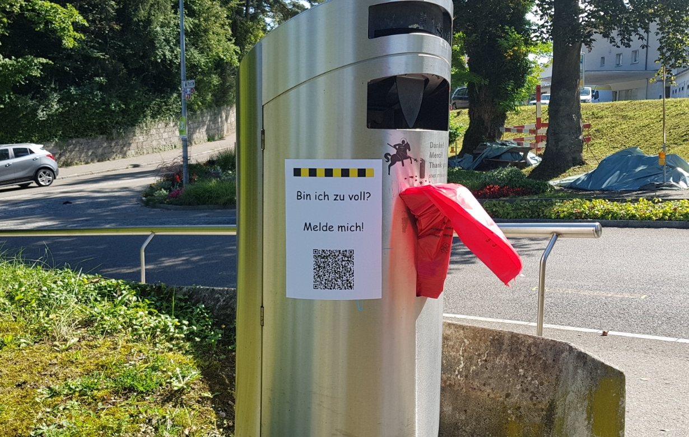
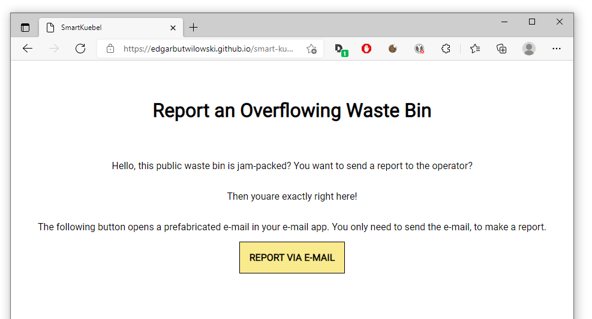
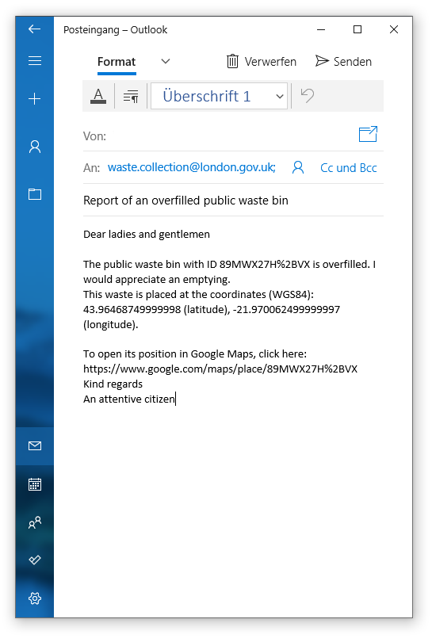
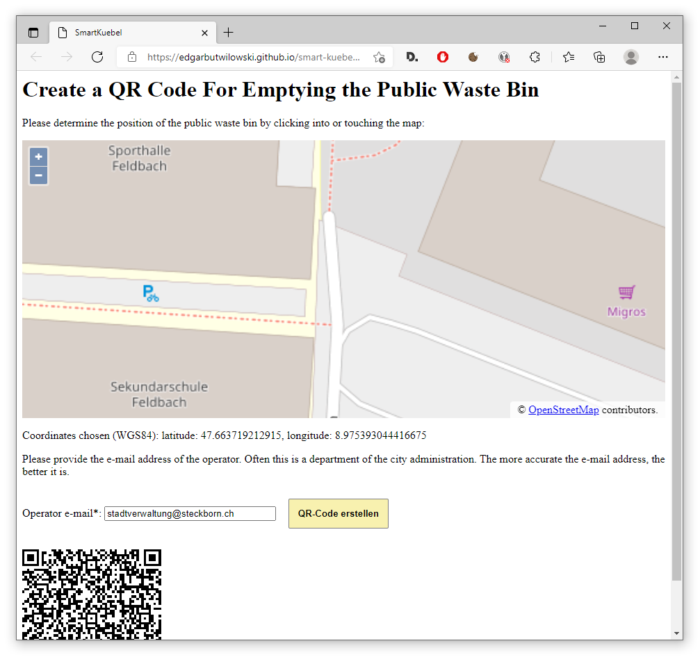

**I cannot emphasize enough how much I love simple solutions for complex problems. In this article, a simple approach for a problem from everyday life is introduced: cramped public waste bins. The beauty of this particular Smart City solution is that it can be addressed by individual citizens - by the civil society. So, you can make the difference.**

Imagine the following situation: You are walking through the city and you have some litter on your hand that you want to get rid of. You see a public waste bin, move closer and realize that it's completely jam-packed. There is even garbage already lying on the street around the bin.

As an active, participating and positive citizen, as you are, you are eager to report this infrastructural challenge to the city administration. But then you realize that the reporting is such a laborious process that you rather get frustrated and give up on the effort.

Well, there is a convenient way to fix such issues. It can be fixed by the city administration, using QR labels on the waste bins. Then, citizens can easily report, when the bin is full, by simply scanning the QR code with their smart phone. However, not many cities provide this public service. Often, the reason for not providing such a service, is a complex and costly IT infrastructure for the system. The solutions that are provided by vendors often are complex, they comprise databases, a middleware with web services, a client application, a management application and so on. In many cases, there is even not only one client application but many client applications - one for each smartphone operating system (Android, iOS). Those client applications have to be maintained which adds additional costs.

Well, how about providing the same public service with only one web based client application - **no database, no backend, no web services**. Modern web technologies make this possible, and I will soon present how. It gets even better: The city administration does not even have to host the client application, this can be done e.g. on GitHub Pages - for free. So there are no costs to operate the IT infrastructure for this public service, which are very good news for the tax payer. And the solution can easily be moved to other providers than Github, so there is even no vendor lock-in involved.

The application I am talking about is called "SmartKübel" (you can also spell it as "SmartKuebel"). It is open source, the source code is provided under the free MIT license in the following GitHub repository:

<https://github.com/edgarbutwilowski/smart-kuebel>

The challenge that I often encountered, is that it still can be quite difficult to convince some city administrations to introduce such a system, even if it is a civil project and available for free. Now comes the good part: With the approach I will present, the city administration does not even have to introduce a new system into their processes. You can do it for them! :)

This is a chance to hack your city. "Hacking" is meant here in the positive sense of constructive hacking. You can simply do that by printing a waterproof sticker in a standard printer format (e.g. A4) and affix it onto a public waste bin, like this:

The sticker says something like "Am I too full? Place report about me!" in German. With this simple sticker, you can transform any old dumb waste bin into a futuristic and smart waste bin - it's that easy.

Of course, you first need to ask your city authorities to print and glue on their bins. By the way, waterproof sticker paper for the home printer is available from most of the office supplies shops.

So how does it work? The QR code on the public waste bin encodes a URL to an HTML page that is hosted on Github Pages. So, in this case, not only the source code is provided on GitHub but the application itself too, through GitHub Pages. This is an example URL that could be encoded by such a QR code on a bin:

_[https://edgarbutwilowski.github.io/smart-kuebel/index.html?code=89MWX27H%2BVX&mail=mail.address@office.gov](https://edgarbutwilowski.github.io/smart-kuebel/index.html?code=89MWX27H%2BVX&mail=mail.address@office.gov)_

If you open the above link (on desktop, tablet or mobile, does not matter), you will see a page similar to the following:

So this is the page that the citizen will see e.g. on his smartphone after he has scanned the QR code on the overfilled bin. This web page directly gives the possibility send a report about the overfilled bin to the operator. It is only two clicks away... After the user clicks the "REPORT VIA E-MAIL" button, his standard e-mail app opens with a completely prepared report e-mail which looks like this:

The e-mail already contains all the relevant information for the operator. Especially it contains the geographic coordinates of the overfilled bin and even presents a link to Google Maps that directly opens its position on the map.

The reporting citizen only needs to hit the send button in his e-mail app. That's it.

So let's have a closer look at the HTML page on Github pages. This page really only contains some HTML, CSS and just a bit JavaScript. **No framework, no backend, no webservice, no application server, even no database is involved.** How can this be true, to provide such a sophisticated service? Well, the URL that opened the page from the QR code already contained two parameters, one is the location code (_code_), the other is an e-mail address (_mail_). Those two parameters were encoded in the QR code and are crucial to the functioning of this solution.

Let's have a closer look at both parameters. The e-mail address has to be the one of the public waste bins operator. This is usually the city administration. So typically, a valid e-mail address in this regard would be something like: waste.collection@london.gov.uk. This e-mail address is then used in the "mail to" section of the prepared e-mail.

The other parameter is a location code in the form of the standardized _Open Location Code_. The location code encodes the geographic coordinates of the public waste bin in a shortened code (only 11 characters). So this code comprises an ID of the bin and its position coordinates in one value.

Again: This is all that this web app needs in order to fully operate. But now comes the important question: How is the QR code generated in the first place? Well, there is a web app for that. This "web app" simply is another HTML page ("createqr.html") in the same Github repository.

You can open this other web app with the following link:

<https://edgarbutwilowski.github.io/smart-kuebel/createqr.html>

If you open that link, you will see a web page like this:

The page only contains an interactive web map - based on _OpenStreetMap_ data - and an input text field for one e-mail address.

So this is the "helper app" for the citizen, who wants to create a new QR code in order to adjoin a new public waste bin to the system. There are only two things to do in order to create a QR code.

First, you need to click into the map to define the exact position of the waste bin. If you do so, you will not see any marker in the map but the clicked position is printed under the map as "Coordinates chosen" (see in screenshot above). You can click as often as you like into the map in order to refine the coordinates values.

Second, you need to type in the valid e-mail address of the public waste bin operator. Sometimes you will have to do some research to get the correct address. However, it is mandatory that you make precise arrangements with the operator, before you use their e-mail address in this setting, so that they are prepared and know what happened when they receive such an "automatic" e-mail that originated from a QR code scan.

After you have defined the geographic position and a valid e-mail address, you can click the "Create QR code" button. As a result, the QR code will be faded in at the bottom of the same web page (see screenshot above). The QR code is a simple image in PNG format. You can save it locally (for example by using right click, then "save as") and insert it into your printing material, as you like. For the sticker on the photography at the top, I used a simple Writer text document where I inserted the QR code from the page.

In this article, I presented an architecturally very simple smart city setup that can be used to report overfilled waste bins to the operating organization. It is easy to use, uncomplicated to setup and modest in maintenance. Furthermore, the illustrated approach is citizen centric and promotes activation of the civil society. You are free to use it, if you like to.

The web apps are localized in two languages: English and German. If you would like to support this project, I would be happy to receive language locales for further languages. Please contact me in that case.
