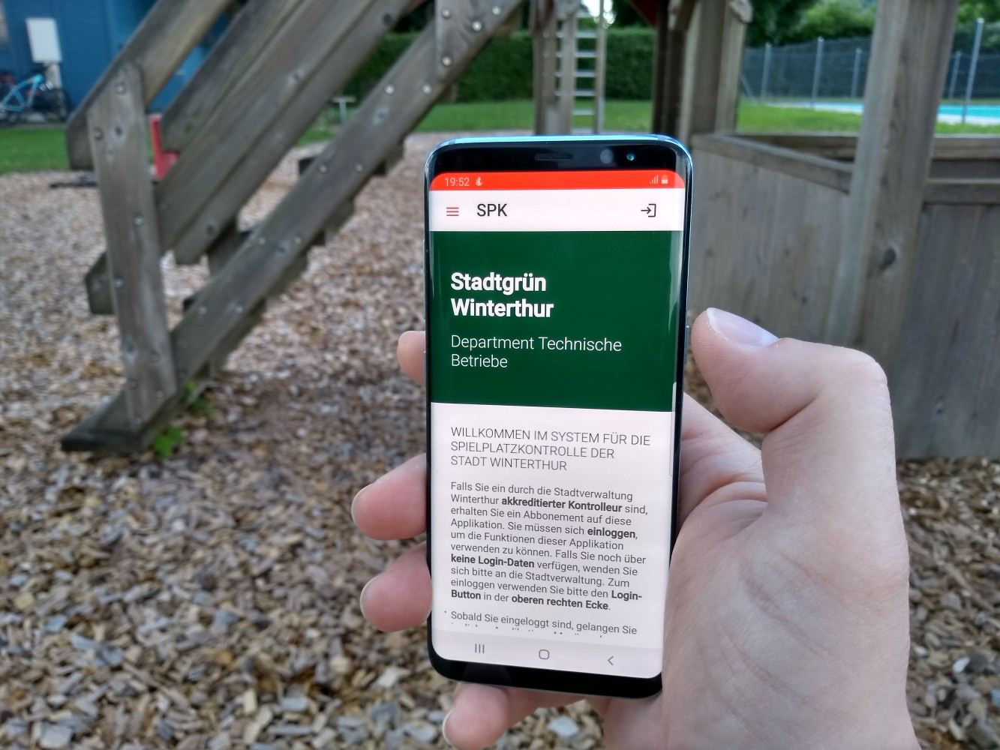
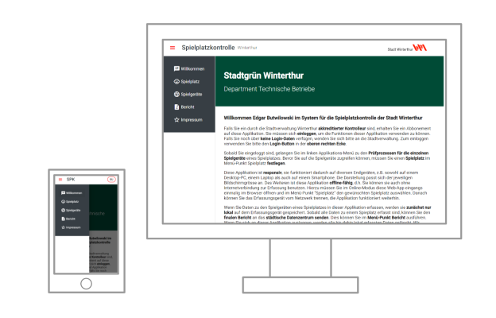
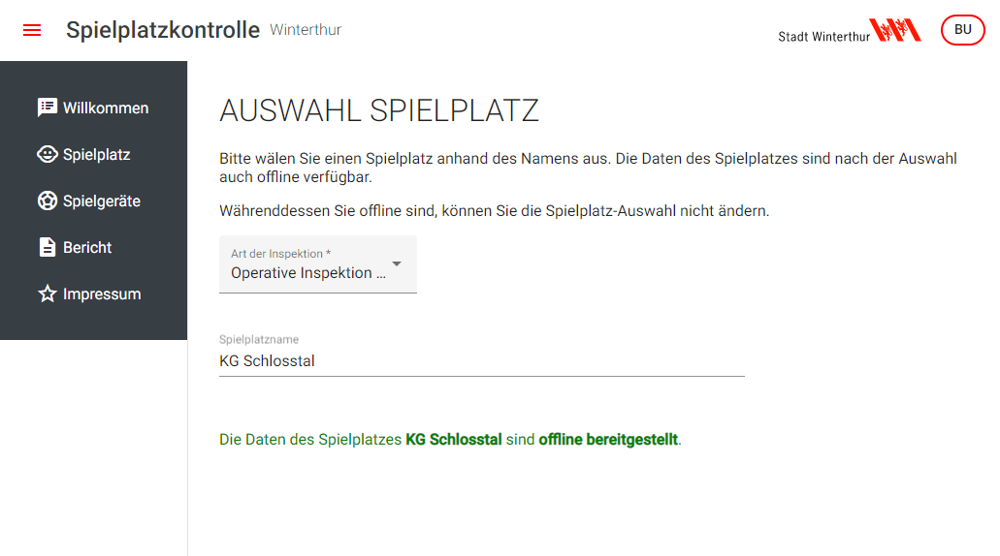
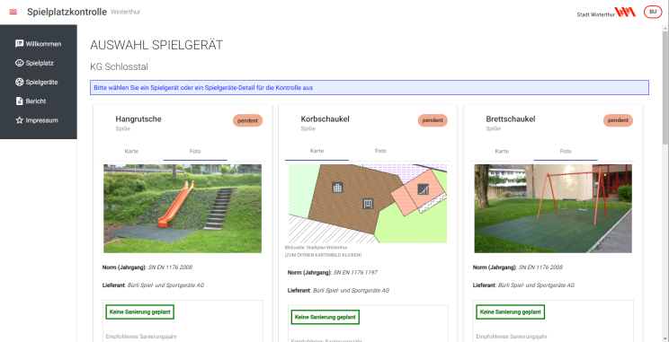
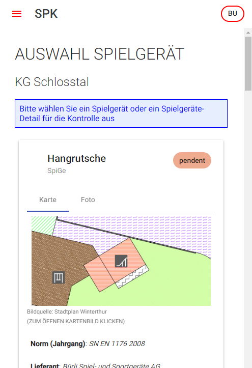
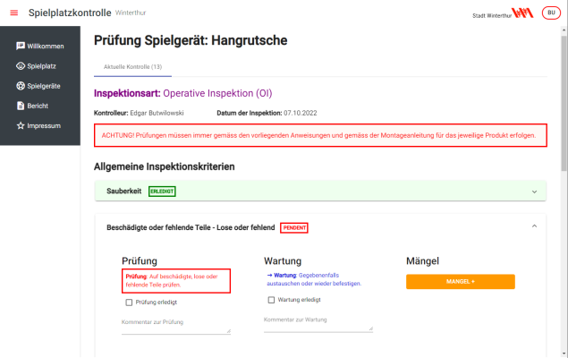
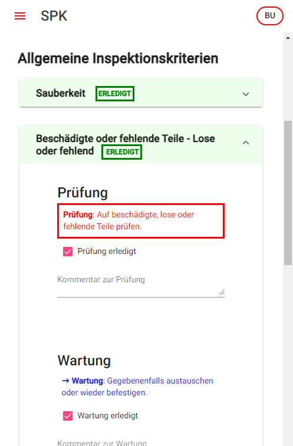
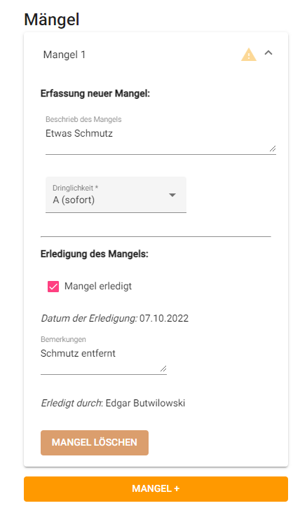
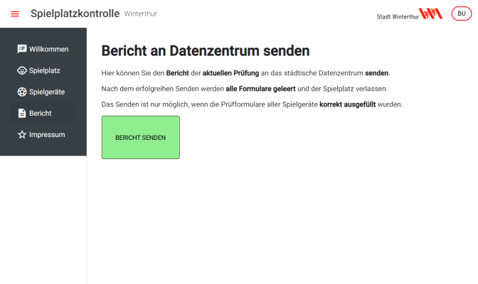
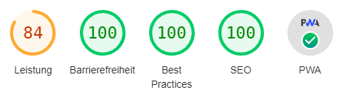

**Die regelmässige Kontrolle und Wartung von Spielplatzgeräten gehört zu den Kernaufgaben einer Kommune. Eltern wollen sich darauf verlassen können, dass die Spielgeräte auf einem öffentlichen Spielplatz nicht zur Gefahr für ihre Kinder werden. Das Management der Kontrollen ist daher oftmals ein massiver Verwaltungsakt mit viel Papieraufwand. Die Stadt Winterthur hat diesen Geschäftsprozess nun durchgängig digitalisiert und damit eines der modernsten Systeme im Praxiseinsatz.**

Winterthur ist mit knapp 110'000 Einwohnern die sechstgrösste Stadt der Schweiz. Als eine Stadt dieser Grösse betreibt Winterthur rund 170 Spielplätze mit insgesamt ca. 1'300 einzelnen Spielgeräten (Stand 2021). Alle Spielgeräte müssen regelmässig, d.h. wöchentlich, monatlich und jährlich kontrolliert werden. Bei den Kontrollen sind diverse Normen einzuhalten, wie z.B. SN EN 1176 und EN 16630, es handelt sich also um einen relativ standardisierten Prozess. Alle Kontrollen sind sorgfältig zu protokollieren, um sie nachvollziehbar zu machen. Diese Zahlen illustrieren, welch grossen Arbeitsaufwand allein die Protokollierung der Spielplatzkontrollen für eine grössere Kommune darstellt.

In Winterthur werden die Prüfungen durch städtische Inspektoren und durch akkreditierte Kontrolleure aus der Privatwirtschaft durchgeführt. Insgesamt sind ca. 30 Prüfer im Einsatz. Für die Koordination der Kontrollen der Spielplätze in Winterthur zeichnet Stadtgrün Winterthur der Technischen Betriebe federführend. Stadtgrün Winterthur hat sicherzustellen, dass alle Prüfungen vollständig protokolliert werden.

Aufgrund des enormen Aufwands der "analogen" Protokollierung hat sich Stadtgrün Winterthur entschieden, diesen Geschäftsprozess vollständig zu digitalisieren und dadurch effizienter zu gestalten. Da es sich bei den Spielplätzen und Spielgeräten um Geodaten handelt, hat sich Stadtgrün Winterthur mit diesem Anliegen an die Winterthurer _Fachstelle Geoinformation_ (FGI) gewandt. Die FGI ist stadtweit für den Betrieb und die Weiterentwicklung der Geodaten-Infrastruktur verantwortlich und unterstützte Stadtgrün Winterthur bei dieser Geschäftsprozess-Optimierung. Gemeinsam konnten Stadtgrün Winterthur und die FGI eine zeitgemässe Lösung implementieren und in den produktiven Betrieb überführen.

Trotz des enormen Umfangs der angestrebten Lösung, war das Projekt in der FGI ein "Zwei-Personen-Job". Dies ist auch dank einer neuen Generation der Werkzeuge zur Software-Entwicklung möglich geworden, die eine bis dahin nicht geahnte Effizienzsteigerung mit sich bringt. Mein Arbeitskollege Martin Suter hat die Anforderungen eingeholt und das Konzept geschrieben, das Datenbank-Schema angepasst, sowie die internen Systeme und Applikationen entsprechend den neuen Anforderungen umkonfiguriert. Frontend und Backend der neuen Web-Applikation für die Kontrolleure habe ich programmiert. Die Entwicklungszeit betrug ca. zweieinhalb Monate innerhalb des normalen Betriebs, also neben allen anderen IT-Tätigkeiten des Alltagsbetriebs. Solche Web-Applikationen waren vor einigen Jahren nur mit grösseren Programmier-Teams realisierbar. Heute kann dies von einem Programmierer als ein Teilprojekt von vielen geleistet werden.

## Anforderungen einer neuen Generation

Dabei waren die Anforderungen an die zukünftige WebApp recht hoch. Das grundsätzliche Ziel war es, eine Applikation für die Protokollierung von Spielgerätprüfungen bereitzustellen. Da die App sowohl von internen als auch von potenziell wechselnden externen Auftrags-Mitarbeitern zu verwenden wäre, sollte sie möglichst einfach zugänglich sein, also möglichst ohne aufwändigen Installationsprozess auskommen. Dies legt eine Web-Applikation nahe, die durch den einfachen Aufruf einer URL sofort startet.

Da es eine zentrale Aufgabe der Applikation ist, festzuhalten welcher Kontrolleur einen Spielplatz geprüft hat, muss sie natürlich auch mehrbenutzerfähig sein. Jeder Kontrolleur muss sich also einloggen, bevor er mit der Protokollierung des Spielplatz-Checks beginnen kann. Durch die Authentifizierung des Prüfers hat das System die Möglichkeit, automatisiert den Ident des Kontrolleurs mit zu protokollieren.

Als zusätzliche Anforderung kam hinzu, dass die Prüfer die volle Freiheit bei der Wahl des zur Protokollierung verwendeten Endgeräts haben sollten - inkl. "Bring-Your-Own-Device" (BYOD). In der Konsequenz bedeutet dies, dass die Applikation auf diversen Geräteklassen (Desktop, Laptop, Android-Phone, iPhone etc.) sowie Betriebssystemen lauffähig sein muss. Auch dies legt eine Web-Applikation nahe, mit der zusätzlichen Anforderung, dass sie auf unterschiedlichen Bildschirmgrössen bedienbar bleiben muss. Die Bedienoberfläche (UI) sollte sich also ohne Einschränkungen der jeweiligen Bildschirmgrösse anpassen können (sog. "Responsive Design").

Vielmals gibt es spezielle Benutzeroberflächen für Smartphones, Tablets und Desktops. Dies hat zur Folge, dass jede Benutzeroberfläche unabhängig voneinander, separat programmiert werden muss. Die Idee von responsiven Apps ist es, dass nur eine Benutzeroberfläche programmiert wird, diese eine Benutzeroberfläche sich jedoch dynamisch und vollautomatisch den unterschiedlichen Bildschirmgrössen ideal anpasst.

Bei einer zeitgemässen WebApp sollte das UI jedoch nicht nur responsiv, sondern auch reaktiv sein. Das "Reactive Design" fordert, dass die Bedienoberfläche dynamisch ist und jederzeit den aktuellen Stand der Daten widerspiegelt. Das heisst, bei Änderung der Daten wird möglichst zeitnah auch das UI automatisch aktualisiert. Vorbei sind die Zeiten von "Aktualisieren"-Knöpfen, die der Benutzer erst manuell drücken muss, damit das auf dem Bildschirm dargestellte auch dem tatsächlichen internen Datenstand entspricht.

Umgekehrt ist kein Klicken von "Speichern"- oder "Abbrechen"-Buttons mehr notwendig, daher verschwinden diese aus dem reaktiven UI. Stattdessen wird bei Eingaben durch den Benutzer möglichst sofort gespeichert. Dieses Verhalten einer Applikation kommt aus der Welt des mobilen Arbeitens auf dem Smartphone. Hier wird angenommen, dass ein Benutzer auch unterwegs Aufgaben mit dem Smartphone erledigt und daher die Gefahr einer Unterbrechung jederzeit besteht (z.B. wenn am Bahnhof der Zug einfährt, der Benutzer einsteigen muss und die App daher temporär schliesst). Daher wird jeder vorgenommene Arbeitsschritt umgehend zumindest lokal auf dem Gerät gespeichert. Ganz im Sinne des "Mobile First"-Prinzips wird diese Verhaltensweise von Applikationen zunehmend auch auf dem Desktop populär, sodass sich eine Applikation sowohl auf dem Desktop als auch im mobilen Modus für den Benutzer gleich verhält.

Eine weitere besondere Erfordernis entstand aus der Gegebenheit, dass Winterthur eine recht "grüne" Stadt ist und daher einige städtische Spielplätze in bewaldetem Gebiet liegen, in dem die Funknetzverbindung durch Verschattung schlecht oder gar nicht gegeben ist. Dadurch muss die Applikation also auch offline-fähig sein. Sie sollte auch dann noch funktionieren und bedienbar bleiben, wenn gar keine Netzverbindung mehr besteht. Daraus ergab sich nun also die Anforderung, dass eine WebApp benötigt wurde, die offline-fähig sein sollte. Aber ist so etwas technisch überhaupt möglich? Schliesslich ist doch der Webbrowser, in dem die WebApp läuft, der Inbegriff für Internet-Konnektivität. Kann eine WebApp in einem Webbrowser ohne Internet überhaupt geöffnet, geschweige denn genutzt werden?

Dank neuer Browser-Technologien und -Standards wie _Progressive Web Apps_ (PWA) ist dies seit kurzem möglich. PWAs erlauben es, dass WebApps beim ersten Starten durch den Benutzer vom Browser lokal auf dem Endgerät gespeichert werden und ab dann auch offline bereitstehen. So kann auch bei Verbindungsabbruch mit der WebApp weitergearbeitet werden. Damit eine PWA funktionieren kann, müssen vom Programmierer freilich besondere konzeptionelle Vorüberlegungen getroffen werden. Die Applikation muss schliesslich jederzeit mit Online- und Offline-Modus und beliebigen temporären Kombinationen davon umgehen können. Mit einer strukturierten Herangehensweise und bei Verwendung moderner Systemumgebungen stellt das jedoch tatsächlich kein technisches Problem mehr dar.

## Die Zukunft der Fachapplikation

Die Spielplatzkontroll-Applikation ist keine Endbenutzer-App, sie ist eine Business-to-Business-Anwendung (B2B) und wird von den Endkunden (in diesem Fall den Spielplatz-Nutzern) normalerweise gar nicht gesehen (und doch spielt sie für die sichere Benützung eines Spielplatzes eine zentrale Rolle). Letztendlich ging es also um nicht weniger als die Entwicklung einer Fachapplikation der nächsten Generation. Sie sollte daher

* ein modernes Design aufweisen (ein klares, einfaches Design des UI, kein Schnickschnack),
* sie sollte schlank sein (nur für eine eng definierte Aufgabe spezifische Funktionen bieten),
* flexibel (für diverse Gerätetypen) und
* inklusiv/barrierefrei sein (Stichwort Accessability).

## Und das Bestehende fortführen

Wie so häufig bei Projekten, die im Kontext von bereits produktiven Umgebungen agieren, muss das bestehende Umfeld mit betrachtet und in die Lösungsfindung einbezogen werden. So war es hier nicht anders. Denn für die Protokollierung von Spielgerätkontrollen werden zunächst Informationen über die vorhandenen Spielplätze und Spielgeräte selbst benötigt, sodass eine Zuordnung der Kontrollen zu den richtigen Spielgeräten überhaupt erst möglich wird. Diese Daten liegen bei Stadtgrün Winterthur bereits vor, sie werden längst als digitale Objekte in einem stadtinternen _Geoinformationssystem_ (GIS) durch Stadtgrün Winterthur gepflegt.

Konkret kommt hier das "schwergewichtige", professionelle Desktop-GIS AutoCAD Map zum Einsatz. Dabei handelt es sich um ein Expertensystem, das von gut ausgebildetem Personal bedient wird. Dieses System ist bei den Technischen Betrieben bereits gut eingespielt und auch stark vernetzt mit der restlichen Geodateninfrastruktur der Stadt. Aus diesem Umstand entsteht für die neue Prüf-WebApp zwangsläufig die zusätzliche Anforderung, dass sie sich in diese bestehende System-Umgebung möglichst transparent (also ohne Medienbrüche) einfügen muss.

## Kommen Sie mit zu einem Spielplatz-Check

Aber nun genug der Theorie, kommen wir zur Praxis. Schauen wir uns die Spielplatzkontrolle-WebApp im Praxiseinsatz an, indem wir zu einer Spielplatzkontrolle "mitgehen". Zur Unterstützung beim Spielgeräte-Check kann nun der Kontrolleur die Spielplatzkontrolle-App zum Beispiel auf seinem Smartphone starten, er sieht dann zunächst die Startseite:

Auf dieser werden nur einige Basisinformationen über die Bedienung bereitgestellt, jedoch stehen ohne ein Login keine Funktionen bereit.

Doch bereits an dieser Stelle kommt das Responsive Design der Applikation zum Tragen, denn die Applikation versucht unterschiedliche Bildschirmgrössen so gut es geht auszunutzen. So wird das linksseitige Hauptmenü auf dem Smartphone ein- und ausfahrbar, so wie viele dies von Smartphone-Apps gewohnt sind. So wird auf dem kleinen Display Bildschirmplatz gespart. Auf dem Desktop hingegen besteht keine Notwendigkeit, diesen Platz einzusparen, daher wird aus Komfort-Gründen das Hauptmenü linksseitig immer vollständig eingeblendet und verdeckt nie den Hauptinhalt.

Hier zeigt sich also bereits, wie die App sich dynamisch an die Bildschirm Grösse anpasst, um die Bedienbarkeit zu gewährleisten.

Nachdem sich jedoch der Kontrolleur mit seinem individuellen Account angemeldet hat, stehen ihm die zusätzlich App-Bereiche

* "Spielplatz" (für die Spielplatz-Auswahl bzw. für das Spielplatz-"CheckIn"),
* "Spielgeräte" (zur Spielgeräte-Auswahl und zur Protokoll-Durchführung), sowie
* "Bericht" (zum Senden des fertig abgeschlossenen Protokolls an den Datenhub der Stadt Winterthur)

zur Verfügung.

Die Bereiche werden in genau dieser Sequenz vom Kontrolleur durchschritten (Spielplatz -> Spielgeräte -> Bericht).

Die Webseite zur Auswahl des Spielplatzes ist auf den ersten Blick recht einfach gestaltet:

Doch verbirgt sich dahinter bereits eine Logik, die je nach eingeloggtem Kontrolleur und ausgewählter Kontrollart nur die passenden Spielplätze überhaupt erst zur Auswahl bereitstellt, um den Benutzer bereits hier zu unterstützen.

Sobald der Benutzer an dieser Stelle einen Spielplatz auswählt, werden die gesamten Daten des Spielplatzes heruntergeladen und für die Offline-Nutzung bereitgestellt. Danach könnte ein ganzer Spielplatz auch vollständig offline geprüft und protokolliert werden. Um diese Funktionalität bereitzustellen, verwendet die WebApp eine lokale Datenbank, die nur innerhalb des Webbrowsers des Benutzers existiert. Hierfür wird eine moderne Webbrowser-Basistechnologie verwendet, die jedoch bereits in allen gängigen Browsern integriert ist.

Die Funktionalität, Daten offline im Browser verfügbar zu halten und damit eine ganze WebApp offline bereitzustellen ist zwar schon längstens standardisiert und in allen gängigen Browsern schon seit einiger Zeit realisiert. Jedoch ist dem Autor selbst bis heute kaum eine WebApp bekannt, die vollständig offline funktionieren kann. Insofern sind wir mit dieser Applikation vorne mit dabei bei den aktuellen technologischen Entwicklungen des Internets. Wir haben nun eine App im produktiven Einsatz, die beispielhaft zeigt, wie die neuen Offline-Funktionen des Browsers sinnvoll verwendet werden können. Dies ist ein Schritt mehr bei dem anstehenden Weg der Ablösung von klassischen Desktop-Applikationen durch moderne WebApps.

## Das Quartett der Spielgeräte

Nachdem der Kontrolleur einen Spielplatz ausgewählt (und offline bereitgestellt) hat, kann er sich im nächsten Schritt die zu prüfenden Spielgeräte des Spielplatzes ansehen, indem er den Menüpunkt "Spielgeräte" auswählt:

Die Webseite der Spielgeräte zeigt eine Übersicht aller Spielgeräte des ausgewählten Spielplatzes. Dabei wird jedes Spielgerät in Form einer Spielkarte (ähnlich wie bei einem Quartett) dargestellt und zur Auswahl angeboten. Eine "Quartett-Karte" enthält dabei ein Foto des Spielgeräts, sowie die Bezeichnung, den Prüfstatus, den Hersteller und diverse weitere (auch dynamische) Informationen über das Spielgerät, die den Kontrolleur dabei unterstützen sollen, einen schnellen Gesamteindruck zum Spielgerät zu gewinnen.

Zur weiteren Unterstützung enthält jede Quartett-Karte auch eine geographische Karte, die den Spielplatz zeigt und auf die Position des Spielgeräts zentriert. Damit das möglich ist, wurden alle Spielgeräte im städtischen Datenbestand durch Stadtgrün Winterthur mit Geo-Koordinaten versehen (sog. Geodaten). Die kleinen Kartenbilder selbst werden vom Digitalen Winterthurer Stadtplan (stadtplan.winterthur.ch) geliefert, der im übrigen auch diverse weitere nützliche Karten für die Winterthurer Stadtbevölkerung und andere Interessierte kostenfrei bereitstellt. Die Kartenbilder lassen sich auch klicken und führen dann auf die Position des Spielgerätes in einer interaktiven Web-Karte, die auch vom Stadtplan Winterthur bereitgestellt wird.

Grundsätzlich hat die Darstellung von Datenobjekten in Form von Quartett-Karten gleich zwei Vorteile:

1. Die Darstellung bleibt funktional auf einer Vielzahl von unterschiedlichen Bildschirmgrössen.
2. Die Darstellung unterstützt das Prinzip der "Gamification" (denn Bildschirm-Arbeit darf auch mal Spass machen).

Die erste Eigenschaft wird übrigens dadurch erfüllt, dass sich solche "Spielkarten" auf einem Bildschirm beliebig neben- oder untereinander anordnen lassen. Wird die App also auf einem grossen und breiten Bildschirm ausgeführt (Desktop), so kann sie automatisch mehrere Spielkarten nebeneinander legen und so den zur Verfügung stehenden Bildschirmplatz voll nutzen. Wird die App hingehen auf einem kleinen, schmalen Bildschirm verwendet (Smartphone) so platziert sie die Spielkarten automatisch untereinander, also nur eine Karte pro Zeile:

Dadurch müssen die Inhalte nicht unnötig in den kleinen Bildschirm "gepresst" werden. So bleiben die Informationen auch auf einem kleinen Bildschirm lesbar und die Schaltflächen bedienbar.

## Die Kontrolle kann beginnen

Auf der Quartett-Karte eines jeden Spielgeräts befindet sich ein Button, mit dem sich das Protokoll-Formular der Prüfung öffnen lässt. Ein typisches Formular sieht folgendermassen aus:

Dies ist als Beispiel das Protokoll-Formular einer Hangrutsche. Sie umfasst 13 einzelne Kontrollschritte, die durchgeführt und protokolliert werden müssen. Jeder Kontrollschritt wird im Formular graphisch von einem sog. "Expansion Panel" eingerahmt. Dadurch lassen sich die einzelnen Teilkontrollen in der Benutzeroberfläche übersichtlich und komfortabel ein- und zuklappen. Dies sind genau die Kontrollschritte, die durch die Normen standardisiert vorgegeben sind. Dadurch wird sichergestellt, dass die gesamte Spielgerätprüfung der entsprechenden Normierung genügt.

Auch das Kontroll-Formular funktioniert im übrigen wunderbar auf kleineren Bildschirmen wie einem Smartphone. Hierbei werden die einzelnen Formular-Elemente untereinander statt nebeneinander (vgl. Desktop) platziert, das sieht dann so aus:

Dies geschieht automatisch und fliessend bei einem zunehmend kleineren Bildschirm, sodass das Formular auf unterschiedlichen Bildschirmformaten (Desktop, Tablet, Smartphone) gut les- und bedienbar bleibt.

Welche Kontrollen werden denn nun konkret mit der App protokolliert? Die einzelnen Schritte einer Spielgerätekontrolle sind z.B. die Prüfung auf "Sauberkeit" oder Prüfung auf "beschädigte oder fehlende Teile" (siehe Screenshots oben). Zu jedem Kontrollschritt gibt es eine Beschreibung, was zu prüfen und wie die Wartung durchzuführen ist. So ist z.B. für "Beschädigte und fehlende Teile" als Prüfung vorgeschrieben:

* "Auf beschädigte, lose oder fehlende Teile prüfen"

und bei der Wartung wird vorgegeben:

* "Gegebenenfalls austauschen oder wieder befestigen".

Diese beiden Tätigkeiten muss der Kontrolleur nun also ausführen und protokollieren. Das Formular ist interaktiv, der Kontrolleur hat daher die Möglichkeit, die einzelnen Kontrollen "abzuhaken". Zusätzlich können an dieser Stelle Kommentare zur Arbeit erfasst werden, die in das Protokoll mit eingehen und später nachgeschlagen werden können.

Sobald Prüfung und Wartung eines Kontrollschritts abgehakt sind, wir der gesamte Kontrollschritt von "pendent" auf "erledigt" umgestellt und grün eingefärbt. Sind alle Kontrollschritte eines Spielgerätes abgehakt, wird die Quartett-Karte des Spielgeräts in der Übersicht entsprechend auch von "pendent" auf "erledigt" umgestellt. So kann der Kontrolleur in der Gesamtübersicht aller Spielgeräte des Spielplatzes schnell erkennen, welche Spielgeräte noch zu kontrollieren sind.

Zusätzlich zur Prüfung und Wartung der Spielgeräte, können bei jedem Kontrollschritt auch beliebig viele Mängel erfasst werden. Hier gibt der Kontrolleur einfach eine Beschreibung des Mangels an, sowie die Dringlichkeit der Behebung und ob der Mangel evtl. im gleichen Schritt schon gleich wieder behoben wurde:

Trotz bestehender Mängel kann eine Kontrolle als "erledigt" gelten. Die Mängel werden in das Protokoll aufgenommen und können zu einem späteren Zeitpunkt behoben werden, insbesondere wenn die Dringlichkeit nicht so hoch ist.

Zusätzlich bietet die WebApp noch die Möglichkeit, die Protokolle der beiden letzten Kontrollen vollständig, aber nur mit Leserecht, einzusehen. So kann sich ein Kontrolleur schnell einen Überblick darüber verschaffen, was bisher an dem jeweiligen Spielgerät schon "gelaufen" ist. Es wurde bewusst eine Einschränkung auf nur zwei letzte Kontrollen getroffen, um die App nicht zu überladen.

## Wir beenden die Kontrolle

Zum Schluss, wenn der Kontrolleur alle Prüfungen durchgeführt und diese in der App "abgehakt" hat, lässt sich das Protokoll der Prüfung als Bericht an die städtischen Datenbank-Server senden. Dies ist unter dem Hauptmenü-Punkt "Bericht" möglich. In diesem Bereich befindet sich der Button, um den Bericht abzusenden:

Jedoch ist dieser Button anfangs so lange ausgegraut und nicht klickbar bis alle Prüfungen an allen Spielgeräten vom Kontrolleur durchgeführt und bestätigt wurden. Erst dann wird der Button grün und die Daten können gesendet werden. Nachdem das Protokoll erfolgreich gesendet wurde, wird der zuvor ausgewählte Spielplatz automatisch abgewählt, und es kann bei Bedarf mit einem anderen Spielplatz fortgefahren werden.

Durch diesen Aufbau der App ist ein Offline-Betrieb jederzeit gewährleistet. Wenn der Kontrolleur offline ist, kann er trotzdem die Prüfung aller Spielgeräte lokal protokollieren. Sobald er wieder online ist, also z.B. im Büro oder im Bereich eines gebuchten Mobilfunknetzes, kann er den "Bericht senden"-Button drücken, sodass erst dann der vorbereitete Bericht tatsächlich an das Datenzentrum gesendet wird.

Damit wäre unser virtueller "Besuch" bei einer normierten Spielplatzkontrolle abgeschlossen. Die Daten sind im Rechenzentrum eingegangen und werden dort für spätere Prüfungen, Analysen und zur Überwachung der Tätigkeiten aufbewahrt.

## Eine Audit-Grafik sagt mehr als tausend Worte

Es bleibt noch die Frage offen, welche technische Qualität die WebApp selbst aufweist. Erfreulicherweise gibt es hierfür frei zugängliche automatisierte Audits, die genau das untersuchen.

Um die technische Qualität einer Web-Applikation prüfen zu können, haben moderne Webbrowser wie z.B. Firefox oder Chrome ein Werkzeug zur Auditierung gleich mit eingebaut, das Lighthouse-Audit. Es handelt sich dabei um ein recht umfassendes und aussagekräftiges Audit, das jeder Nutzer selbst bei jeder Website durchführen kann. Hier kann die Spielplatzkontrolle-App mit Bestnoten glänzen. Sie erreicht in fast allen Kategorien (Leistung, Barrierefreiheit, Best Practices und SEO) die höchste Punktzahl von 100:

Dies war zu Beginn nicht so, die App erreichte zunächst wesentlich geringere Bewertungen in allen Punkten. Erst ein iterativer Prozess von permanenter Auditierung und Nachbesserung der Applikation führte zu diesem Punktestand. Erfreulicherweise beinhaltet der ausführliche Bericht des Lighthouse-Audits auch eine genaue Beschreibung, welche technischen Mängel zu Punkteabzügen geführt haben und wie diese Mängel zu beseitigen sind. Das Audit war daher enorm hilfreich für die iterative Verbesserung der App.

Die einzige Ausnahme bildet der Bereich "Leistung". Es geht dabei um die Frage, wie lange die Applikation braucht, vom ersten Aufstarten bis hin zum Zeitpunkt, an dem der Benutzer sie verwenden kann. Hier lässt sich die volle Punktzahl nicht ausschliesslich durch die Programmierung der App erreichen, sondern dies ist auch von der Leistungsfähigkeit der Server-Infrastruktur und des Netzwerks abhängig. Hierbei sei erwähnt, dass die WebApp im Audit schon nach knapp über einer Sekunde verfügbar war. Das Audit ist hier enorm anspruchsvoll und gibt bereits dafür nicht die volle Punktzahl, da bei einigen WebApps manche Benutzer bereits bei diesem kurzen Zeitraum schon "abspringen" und stattdessen zu einer anderen App wechseln. In unserem Anwendungsfall ist jedoch die Bereitstellung einer Applikation innerhalb von einer Sekunde durchaus akzeptabel. Es geht hierbei schliesslich um die Gesamtzeit für den Download, die Installation und das Aufstarten der Applikation. Da ist es zu bedenken, dass bei klassischen Business-Desktop-Applikationen die Bereitstellung durchaus Stunden und Tage dauern kann.

Des Weiteren bewertet das Lighthouse-Audit die Zugänglichkeit bzw. Barrierefreiheit ("Accessibility") der WebApp. Dies bezieht sich auf eine Vielfalt von Techniken der Website-Programmierung, die es ermöglichen, dass eine Website auch von Personen mit speziellen Bedürfnissen gut verwendet werden kann. Menschen mit anderen Sichtfähigkeiten verwenden z.B. Screenreader, um sich die Inhalte einer Webseite maschinell vorlesen zu lassen. Dabei geht es nicht nur darum, den Haupttext einer Webseite vorzulesen, sondern auch darum, auf Bedienelemente sauber hinzuweisen. Eine gut programmierte Website unterstützt die Funktionalität solcher Screenreader. Dies ist aber nur ein Beispiel für viele Technologien, die unter dem Stichwort "Accessibility" subsummiert werden.

Der Bereich "Best Practices" des Audits untersucht die Website allgemein auf einen guten Programmierstil. Dies umfasst auch Fragestellungen der Sicherheits-Technologien, also ob grobe Fehler gemacht wurden, die die Website für den Anwender unsicher machen bzw. typische Sicherheitslücken erzeugen.

Zusätzlich werden Punkte für eine gute Search Engine Optimization (SEO) vergeben, was in unserem Fall jedoch gar keine Rolle spielt, da für diese Art der Business-Applikation nicht relevant ist, ob sie durch Suchmaschinen gut gefunden werden kann bzw. in den Suchergebnissen hoch gelistet wird oder nicht.

Im letzten Abschnitt des Audits wird die Website daraufhin untersucht, ob sie eine gültige Progressive Web App (PWA) ist. Hier wird keine Punktzahl vergeben, sondern einfach nur angegeben, ob es sich um eine PWA handelt oder nicht. Dies trifft für die Spielplatzkontrolle-WebApp zu (das PWA-Abzeichen enthält ein grünes Häkchen). Das bedeutet hauptsächlich, dass diese Website Technologien nutzt, die ihr einige Fähigkeiten, Funktionen und Rechte von fest installierten Applikation gibt, die früher mit reinen Web-Applikationen nicht möglich waren. Die WebApp wirkt dadurch in vielen Aspekten wie eine klassische Desktop-Applikation oder wie eine Applikation, die über einen App-Store fix installiert wurde.

## Fazit

In diesem Blog-Artikel wurde vorgestellt, wie moderne Spielplatzkontrollen mit einem durchgängig digitalisierten Prozess möglich werden. In Winterthur hat die Fachstelle Geoinformation zusammen mit Stadtgrün Winterthur solch einen Prozess implementiert und in den produktiven Betrieb überführt. Dadurch hat Winterthur einen fortschrittlichen und äusserst effizienten Prozess zur Spielplatzkontrolle im Einsatz. Dieser erspart eine Menge "Papierkram", reduziert die Verwaltungsarbeit und ermöglicht trotzdem die volle Nachvollziehbarkeit der Spielgeräteprüfungen.
